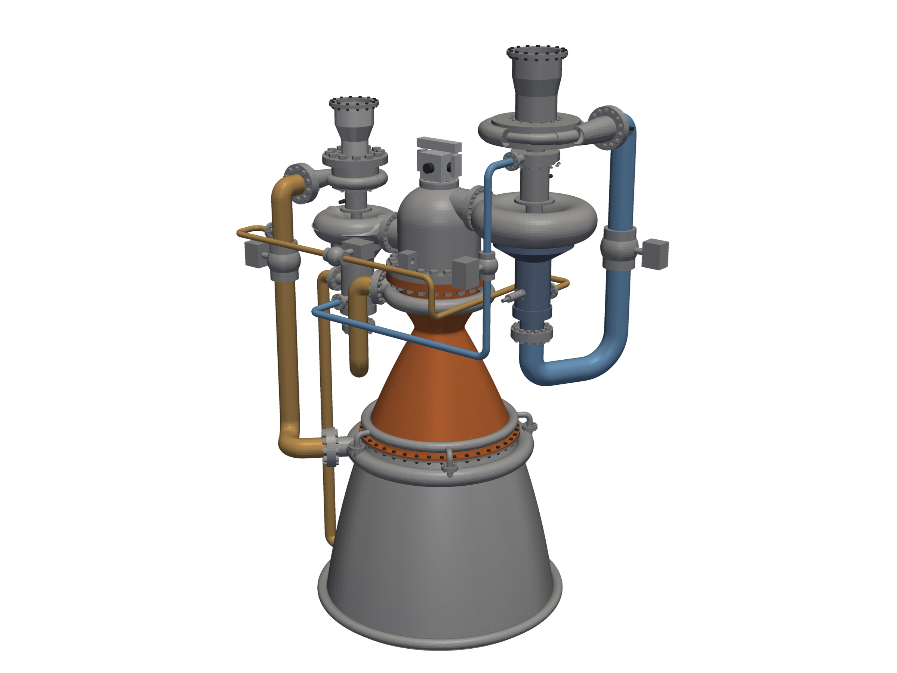
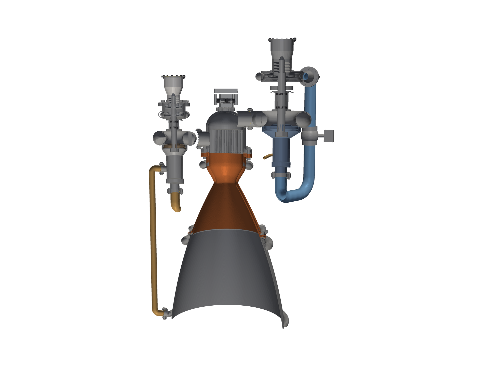

# MFE-280: methalox full-flow staged-combustion engine

A personal design study of a sea-level methane/oxygen engine in the 280 tf class. The requirements come from the public Raptor 3 numbers (280 tf at sea level, 350 s, about 350 bar, O/F 3.6, 1,525 kg); the layout and every sizing decision are my own. I wanted to see how close a first iteration built from open physics models gets, where it falls short, and which changes improve it without adding much complexity.

| Assembly | Half section through the chamber and turbopump axes |
|---|---|
|  |  |

Everything is generated from one design basis (`config/baseline.yaml`):

```
config/baseline.yaml ─► ffsc/ (0-D / 1-D Python models) ─► results/design.json, cooling_profile.csv, contour.csv
                                                         ├─► cad/build_engine.py      FreeCAD assembly, STEP, BOM, clash check
                                                         ├─► picogk/RegenChamber      voxel model of the cooled chamber
                                                         ├─► drawings/src/make_pid_set.py      P&ID set (ISO 10628, ISA-5.1) -> AutoCAD DWG + PDF
                                                         ├─► drawings/src/make_mech_drawings.py engineering drawings -> AutoCAD DWG + PDF
                                                         └─► cfd/make_case.py         OpenFOAM axisymmetric case
```

## Results at a glance

| | MFE-280 baseline | Raptor 3 (public) |
|---|---|---|
| Sea-level thrust | 2.746 MN (280 tf), design input | 280 tf target (2024); 250 tf flight figure (May 2026) |
| Chamber pressure | 350 bar | ~350 bar (2023 test) |
| Mixture ratio O/F | 3.6 | ~3.6 |
| Isp, sea level / vacuum | 333.7 s / 351.8 s | 350 s quoted (see [benchmark](docs/DESIGN_REPORT.md#2-benchmark)) |
| Throat / exit diameter | 235 mm / 1,370 mm | - / ~1.3 m |
| Expansion ratio | 34 | 34.34 (Raptor 1, FAA 2019) |
| Pump discharge LOX / CH4 | 760 / 916 bar | not public |
| Modelled engine mass | 1,868 kg (CAD roll-up); 1,796 kg improved | 1,525 kg |
| Height x width | 3.36 m x 2.24 m | 3.1 m x 1.3 m |

Main findings:

- At 350 bar and O/F 3.6 even an ideal shifting-equilibrium nozzle gives at most 349 s at sea level (NASA CEA: 349.4 s; this project's solver agrees with CEA within 0.14 %). The public "350 s" therefore fits the vacuum Isp of the sea-level engine, and the model gives 351.8 s for that.
- Cooling the 120 MW/m² throat needs a fuel-rich wall layer (outer injector row at O/F 2.0). It costs 4.6 s of sea-level Isp; without it the copper liner cannot be cooled at an acceptable jacket pressure drop.
- The LOX shaft sets the chamber-pressure ceiling. With an 820 K ox-rich preburner, 400 bar does not close the power balance.
- Four low-complexity changes cut the pump discharge pressures by 50 bar (LOX) and 105 bar (CH4) at unchanged Isp: polished AM channels, a 50/50 coolant split, shrouded turbine rotors, and a close-coupled hot-gas path. The CAD mass drops by 72 kg.
- The rest of the gap to Raptor 3 is plumbing, manifolds and flanges (about 600 kg together). The cycle physics is already close to Raptor's, so the remaining mass has to come out through integration.

Full write-up: [docs/DESIGN_REPORT.md](docs/DESIGN_REPORT.md).

## Layout

| Path | Content |
|---|---|
| `config/baseline.yaml` | design basis: every input and assumption |
| `ffsc/` | models: `thermo` (Cantera equilibrium, CEA-style performance), `nozzle` (contour, separation), `cooling` (1-D regen with channel sizing), `cycle` (FFSC power balance), `turbopump`, `injector`, `structures` (bolted joints), `mass`, `design` (pipeline) |
| `scripts/` | `run_design.py`, `run_trades.py`, `run_improved.py`, `make_figures.py`, `render_cad.py`, `render_sections.py`, `validate_cea.py` |
| `results/` | `design.json`, CSV profiles, `trades.json`, `improvements.json`, `improved/` |
| `cad/` | `build_engine.py`, `cadlib.py`, `open_in_gui.py`, `export_meshes.py`; outputs in `cad/output/` (FCStd, STEP per sub-assembly, BOM, clash report) |
| `picogk/` | C# PicoGK/ShapeKernel project for the voxel regen chamber |
| `drawings/` | drawing sets as AutoCAD DWG (2018 format) and PDF: `MFE280-PID-SET.pdf`, `MFE280-DWG-SET.pdf`; sources in `drawings/src/` (template, P&ID tag database, sheet builders) |
| `figures/` | report figures (PDF + PNG) |
| `cfd/` | OpenFOAM case generator and CFD plan |
| `tests/` | pytest checks (conservation, sizing rules) |

## How to run

```bash
.venv/Scripts/python.exe scripts/run_design.py
```

```bash
.venv/Scripts/python.exe scripts/run_trades.py
```

```bash
.venv/Scripts/python.exe scripts/run_improved.py
```

```bash
.venv/Scripts/python.exe scripts/make_figures.py
```

```bash
.venv/Scripts/python.exe drawings/src/make_pid_set.py
```

```bash
.venv/Scripts/python.exe -m pytest -q tests
```

```bash
"/c/Program Files/FreeCAD 1.1/bin/freecadcmd.exe" cad/build_engine.py
```

```bash
"/c/Program Files/FreeCAD 1.1/bin/freecad.exe" cad/open_in_gui.py
```

Renders (tessellate in FreeCAD, draw offscreen with PyVista):

```bash
"/c/Program Files/FreeCAD 1.1/bin/freecadcmd.exe" cad/export_meshes.py
```

```bash
.venv/Scripts/python.exe scripts/render_cad.py
```

Section views with hatched cut faces (quarter cutaway, x-z and y-z sections, both turbopumps, a horizontal cut and the injector face) go to `figures/sec_*.png`:

```bash
.venv/Scripts/python.exe scripts/render_sections.py
```

The design pipeline runs in about 3 s, the trade studies in about 4 min and the CAD build in about 2 min.

Environment: Python 3.12 venv in `.venv` (numpy, scipy, matplotlib, cantera 3.2, CoolProp 8.0, pyyaml, pytest), FreeCAD 1.1, .NET 9 SDK at `D:\Research-Software\tools\dotnet9` for PicoGK 2.3.

## Status

Iteration 1. The physics is first-order (0-D/1-D, ideal gas in the preburners, Bartz heat flux) and the CAD is a layout-level assembly. Open items are listed in [section 13 of the report](docs/DESIGN_REPORT.md#13-limitations-and-next-steps).
