# MFE-280 design report, iteration 1

Sid Sharma, 2026-10-31. Personal project.

## 1. Purpose and scope

MFE-280 is a sea-level methane/oxygen engine with a full-flow staged-combustion (FFSC) cycle. Its requirements match the public Raptor 3 sea-level figures, so every model output can be checked against a known design point; the layout and sizing are my own. The work has four aims:

1. build a traceable design chain from thermochemistry to a bolted CAD assembly, using open tools only;
2. benchmark the result against Raptor 3 and find out where the gaps come from;
3. test changes that improve the design without adding much complexity;
4. leave a clean starting point for CFD.

All models are 0-D or 1-D. They are first-iteration tools, and section 13 lists what they leave out.

## 2. Benchmark

Public Raptor numbers (Wikipedia "SpaceX Raptor", accessed 2026-10-31, which collects SpaceX posts and the FAA material):

| Quantity | Raptor 1 | Raptor 2 | Raptor 3 |
|---|---|---|---|
| Sea-level thrust | 185 tf | 230 tf | 280 tf target (Apr/Aug 2024); 250 tf flight figure (May 2026) |
| Specific impulse (as quoted) | 350 s | 347 s | 350 s |
| Engine mass, engine only | 2,080 kg | 1,630 kg | 1,525 kg |
| Engine + vehicle-side hardware | 3,630 kg | 2,875 kg | 1,720 kg |
| Chamber pressure | ~250-300 bar | - | 350 bar demonstrated (May 2023 test, 269 tf) |
| Expansion ratio (sea level) | 34.34 (FAA 2019 plume analysis) | - | - |
| Mixture ratio | ~3.6 | ~3.6 | ~3.6 |
| Size | 1.3 m diameter, 3.1 m length | | |

The quoted 350 s needs care. At 350 bar, O/F 3.6 and ε 34, an ideal shifting-equilibrium nozzle (this project's Cantera solver, NASA CEA thermodynamic data) gives 349.0 s at sea level and 367.6 s in vacuum. No real engine delivers more than the ideal value, so 350 s cannot be the delivered sea-level Isp. It does fit the vacuum Isp of the sea-level engine. The same holds for Raptor 1's 350 s at roughly 250 bar. This project's sea-level engine delivers 351.8 s in vacuum, which agrees with the quoted figure. This report compares sea-level Isp on that basis.

## 3. Design basis

All inputs are in `config/baseline.yaml`. The main ones:

| Item | Value | Note |
|---|---|---|
| Thrust, sea level | 2,746 kN | 280 tf |
| Chamber pressure | 350 bar | |
| Mixture ratio | 3.6 | |
| Propellants at pump inlet | LOX 70 K, CH4 95 K, 6 bar | subcooled; tank ullage plus liquid head, assumed |
| c* efficiency / vacuum Cf efficiency | 0.990 / 0.980 | gas-gas injection, Rao bell |
| Contraction ratio, L* | 3.0, 0.80 m | |
| Nozzle | Rao 80 % bell, ε 34 | |
| Liner, chamber zone | GRCop-42 (L-PBF), 0.6 mm hot wall, Twg ≤ 880 K | |
| Liner, nozzle zone | Inconel 718, 0.6 mm hot wall, Twg ≤ 950 K | |
| Preburner exit temperature | OPB 820 K, FPB 1,100 K | ox-rich turbine alloy (SX500 class); FPB turbine needs a cast superalloy |
| Main injector dP | 10 % pc | gas-gas |
| Preburner injector dP | 12 % of preburner pressure | |
| Hot-gas duct dP | 3 % pc | |
| Inducer suction specific speed | 32,000 (US units) | NASA SP-8052 range |
| Throttle range | 40-100 % | public Raptor figure |

## 4. Models

### 4.1 Thermochemistry and performance (`ffsc/thermo.py`)

- Cantera 3.2 ideal-gas phase with NASA CEA polynomials (200-6,000 K, `nasa_gas.yaml`) for 18 C/H/O species. Transport properties use GRI-Mech 3.0 parameters (mixture-averaged).
- Reactant enthalpies follow the CEA convention: O2(L) at 90.17 K and CH4(L) at 111.64 K, corrected to the subcooled inlet state with CoolProp. In a closed cycle all pump work returns to the flow through the turbines, so the chamber total enthalpy equals the propellant enthalpy at the pump inlets.
- Chamber state: HP equilibrium. Expansion: isentropic, shifting or frozen. The throat is the point of maximum mass flux along the isentrope, so the method needs no explicit equilibrium sound speed. Exit state: the pressure where Gt/G equals ε.
- Delivered performance: c* × 0.990 and vacuum Cf × 0.980.
- Wall bias: two stream tubes. The wall tube (8 % of the mass flow at O/F 2.0) and the core tube (O/F 3.82) together keep O/F 3.6 overall. Isp and c* are mass-weighted.

Check against NASA CEA (RocketCEA 1.2.3, `scripts/validate_cea.py`, `results/cea_validation.json`). For the same reference liquids, 12 cases (250 and 350 bar, O/F 3.0 to 4.0, ε 12 and 34) agree within 0.14 % on chamber temperature, 0.05 % on c* and 0.04 % on vacuum Isp. At the design point, CEA gives 349.4 s ideal sea-level Isp and this solver gives 349.5 s. The throat Mach number from the maximum-mass-flux search is within 0.05 of 1.

### 4.2 Chamber and nozzle contour (`ffsc/nozzle.py`)

- The cylinder length is solved so that the volume from the injector face to the throat equals L* At.
- Convergent: 30° cone with a 0.6 Rc fillet and a 1.5 Rt upstream throat arc. Divergent: a 0.382 Rt arc, then a quadratic Bézier to the exit (Rao thrust-optimised parabola).
- Bell angles come from a digitised 80 % Rao chart (Huzel and Huang 1992). The error is about ±1°.
- Separation at sea level: Summerfield (pe/pa < 0.4) and Schmucker, pe/pa < (1.88 Me − 1)^−0.64.

### 4.3 Regenerative cooling (`ffsc/cooling.py`)

- Gas side: Bartz (1957) with the σ property correction, recovery temperature with r = Pr^1/3, and stagnation temperature η_c*² Tc of the wall stream tube.
- Wall: 1-D conduction through the hot wall. Ribs are straight fins, with the fin efficiency in the effective coolant-side coefficient.
- Coolant side: Gnielinski with a Haaland rough-wall friction factor, the Norris roughness enhancement and a (Pr/Pr_w)^0.11 correction. Supercritical methane properties come from CoolProp (Setzmann-Wagner EOS).
- Circuit: the coolant enters a manifold at the liner joint (ε 12). Circuit A runs up the copper chamber to the injector end; circuit B runs down the Inconel nozzle to the exit. The coldest methane therefore meets the throat. A single counter-flow pass from the exit was tried first: it needed about 670 bar of jacket pressure drop.
- Channel sizing is the computational step. The channel width is capped by liner bending, σ = ½ Δp (w/t)² (1.0 mm in copper, 2.2 mm in Inconel). Channels bifurcate when a rib would get too wide. At each station the model then finds the tallest channel that keeps the hot wall at its target temperature. Taller channels mean lower velocity and less pressure loss. The sized heights are smoothed conservatively (running minimum, then mean) and the jacket is solved again with that fixed profile. This profile is the geometry input for the PicoGK chamber.
- Structure checks per station: liner bending, rib tension (p w / rib) and the closeout. Coolant pressure inside closed channels is self-equilibrated, so it only bends the closeout across one channel width. Global hoop load comes only from the gas pressure, which sets a 17 mm closeout in the 350 bar chamber and 1 mm at the exit. Sizing it as a full-circumference vessel against coolant pressure would give a 144 mm closeout at the exit.

### 4.4 FFSC power balance (`ffsc/cycle.py`)

```
LOX pump -> MOV -> OPB (+ small CH4 cross-feed) -> ox turbine -> ox-rich gas -> main injector posts
CH4 pump -> MFV -> regen jacket A+B -> FPB (+ small LOX cross-feed via kick stage) -> fuel turbine -> fuel-rich gas -> injector annuli
```

- Preburners: frozen complete combustion of the minor propellant, with the major one unreacted, which is the usual preliminary assumption for short-residence preburners. The minor flow is solved so the frozen adiabatic temperature hits T_opb or T_fpb.
- Pressure chain: turbine exit = pc (1 + main injector dP + hot-gas dP). Preburner = turbine exit × turbine pressure ratio. Pump discharge = preburner × (1 + preburner injector dP) × (1 + line dP), plus the jacket dP on the fuel side.
- Each shaft: turbine power = pump power (+ kick stage on the LOX shaft), solved for the turbine pressure ratio. The balance curve has a maximum, so the solver takes the lowest root and reports when no root exists. That is how the 400 bar and wall-O/F 2.4 cases fail.
- The cooling and cycle models are coupled: the jacket dP and heat pickup feed the cycle, and the fuel-pump outlet state feeds the jacket. Two iterations converge.
- Real-gas check: CoolProp gives Z = 1.21 for O2 at OPB conditions and 1.22 for CH4 at FPB conditions. The cycle uses ideal gas; section 13 covers this.

### 4.5 Turbomachinery (`ffsc/turbopump.py`)

- Shaft speed is set by the inducer: N = Nss NPSH^0.75 / √Q.
- Pump efficiency follows Gülich (2010, eq. 3.28) minus 0.04 for high-speed rocket service. Tip speed comes from a head coefficient of 0.55. The eye, exit width, inducer and volute throat are sized from flow coefficients.
- Turbine: single-stage reaction. The parabolic efficiency curve in u/c0 is multiplied by a tip-clearance loss of 1.5 × clearance / blade height. The mean speed is the value that maximises this product inside the tip-speed and h/D limits. Preburner gas at 650-700 bar is dense, so blades are short (5.9-7.5 mm). The clearance loss is therefore large, and the design is sensitive to it.
- Shaft diameter is sized from torsion at 250 MPa allowable.

### 4.6 Injector (`ffsc/injector.py`)

Gas-gas shear coaxial elements: ox-rich gas in the post, fuel-rich gas in the annulus, 10 % pc dP on both. The element count comes from about 16 kN per element. Ring pitch is the largest that fits the faceplate. Result: 173 elements on 8 rings, 27 mm pitch, 1.6 × the annulus OD. The faceplate open-area fraction of 30 % shows that gas-gas FFSC injection is limited by face area.

### 4.7 Structures and bolted joints (`ffsc/structures.py`)

A VDI 2230-style sizing for every bolted joint:

- separating force at proof pressure (1.2 × MEOP) on the seal diameter, plus external loads (nozzle side load = 5 % of thrust);
- joint stiffness factor 0.25 and separation safety 1.4;
- preload 75 % of bolt proof (A286 760 MPa, Inconel 718 1,030 MPa);
- bolt spacing between 2.5 d (wrench access) and 6 d (seal uniformity);
- flange thickness from ring bending.

If no ISO bolt pattern fits, the joint is marked welded. That happens for the 760 bar LOX pump volute cover and the 665 bar ox turbine housing. Raptor 3 went the same way for its high-pressure joints. The CH4 turbine housing gets an M30 pattern, but its bolt circle lies under the turbine exhaust collector where no wrench can reach, so `ffsc/design.py` welds that joint too.

### 4.8 Verification

`tests/test_models.py` (11 tests, all pass):

- agreement with NASA CEA within 0.3 %; ideal performance in the expected range, and frozen Isp below shifting;
- stream-tube O/F conservation;
- contour throat and exit radius, and L* volume;
- area-Mach inverse;
- F = ṁ Isp g0 and At = ṁ c*/pc;
- preburner mass conservation and shaft power balance;
- jacket energy balance within 3 %, and wall-temperature and stress limits;
- bolt clamp, spacing and stress for every joint;
- a deliberately impossible flange is rejected;
- no separation at 40 % throttle.

## 5. Baseline results

| Quantity | Value |
|---|---|
| Isp sea level / vacuum (delivered) | 333.7 s / 351.8 s |
| Isp without wall bias (same efficiencies) | 338.2 s / 356.6 s |
| Mass flow (LOX / CH4) | 839.2 kg/s (656.7 / 182.4) |
| Vacuum thrust | 2.895 MN |
| Throat / chamber / exit diameter | 235 / 407 / 1,370 mm |
| Chamber length to throat, total length | 351 mm, 2,050 mm |
| Exit pressure, exit Mach | 1.20 bar, 3.66 |
| Chamber temperature (core / wall tube) | 3,785 / 2,546 K |
| LOX pump | 1 stage + inducer, 15,730 rpm, 760 bar, 51.1 MW, η 0.78, D2 404 mm |
| CH4 pump | 2 stages + inducer, 37,870 rpm, 916 bar, 46.5 MW, η 0.80, D2 217 mm |
| Ox turbine | PR 1.68, η 0.78, Dm 380 mm, blade 7.5 mm, 820 K inlet |
| Fuel turbine | PR 1.76, η 0.77, Dm 256 mm, blade 5.9 mm, 1,100 K inlet |
| OPB / FPB | 665 bar, O/F 54 / 697 bar, O/F 0.27 |
| Cross-feeds | 11.3 kg/s CH4 to OPB; 45.9 kg/s LOX to FPB through a +36 bar kick stage |
| Regen jacket | 94.7 MW, 117 bar dP, outlet 313 K, peak heat flux 120 MW/m², peak Twg 880 K |
| Channels | 384 at the throat (1.0 mm x ~12 mm), bifurcating to 768; Inconel nozzle 800-1,600 |
| Thrust-chamber mass (analytic) | 356 kg (liner + ribs 257 kg, closeout 99 kg) |

Figures: `figures/fig01_contour_channels`, `fig02_cooling`, `fig03_pressure_ladder`, `fig08_throttle_separation`.

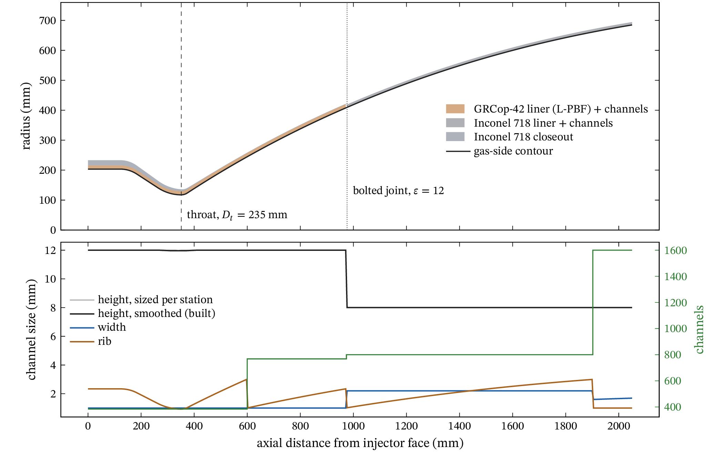
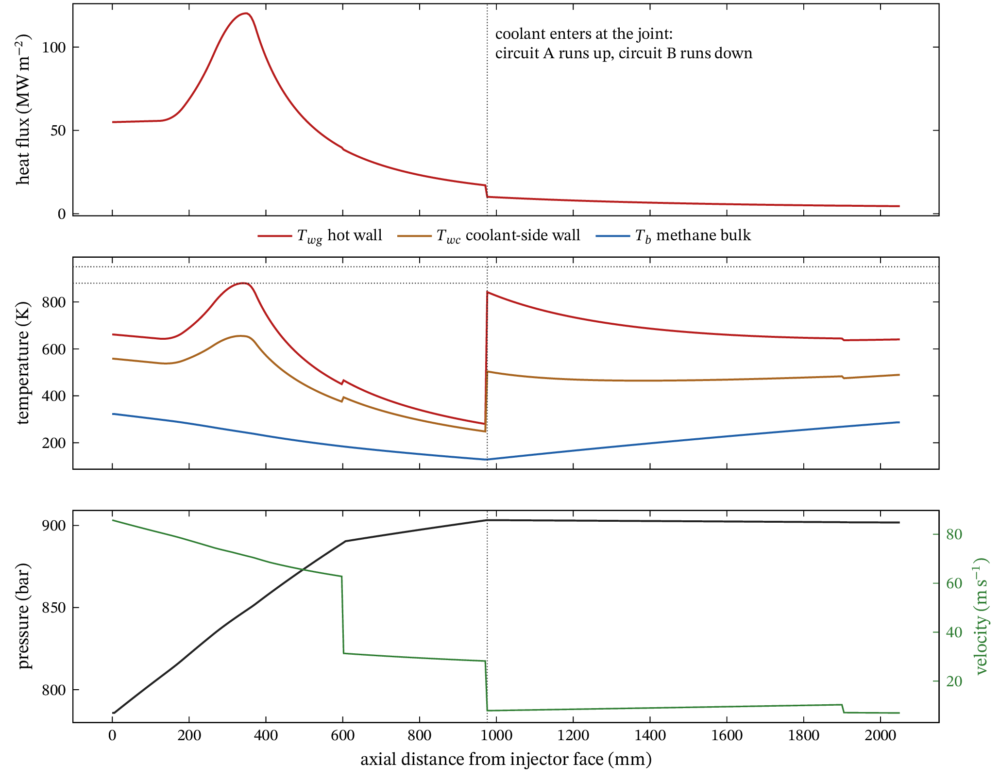

Points worth noting:

- The copper channels end up near the 12 mm height cap all the way through the throat (about 70 m/s methane). With the wall bias in place, throat cooling is not the limit. The jacket dP comes from the long chamber circuit.
- The Inconel hot wall jumps to 840 K at the joint because its conductivity is about 18 times lower than copper's. Moving the joint upstream of ε 12 would push it past 950 K. The joint location is therefore set by the nozzle alloy's temperature limit.
- At 40 % throttle, pe/pa = 0.48 against a Schmucker limit of 0.32 (margin 1.49), so the sea-level nozzle stays attached over the whole public throttle range.

## 6. Benchmark comparison

| | MFE-280 baseline | MFE-280 improved | Raptor 3 public |
|---|---|---|---|
| Sea-level thrust | 2.746 MN | 2.746 MN | 280 tf (2.746 MN) target |
| Isp vacuum, sea-level engine | 351.8 s | 351.8 s | 350 s (quoted) |
| Isp sea level | 333.7 s | 333.7 s | not public in this form |
| Chamber pressure | 350 bar | 350 bar | 350 bar |
| Modelled mass | 1,868 kg | 1,796 kg | 1,525 kg |
| Thrust/weight (sea level) | 150 | 156 | 184 at 280 tf, 164 at 250 tf |
| Exit diameter | 1.37 m | 1.37 m | ~1.3 m |
| Overall envelope | 3.36 m tall, 2.24 x 1.62 m | similar | 3.1 m, 1.3 m diameter |

The modelled mass leaves out harness, controller, actuators and purge lines, so the real gap is somewhat larger than the table shows. MFE-280 iteration 1 sits between Raptor 1 (2,080 kg) and Raptor 2 (1,630 kg). The width gap comes from the LOX turbopump. A 6 bar inlet with Nss 32,000 limits it to 15,700 rpm, which gives a 380 mm turbine and a large exhaust collector.

## 7. Trade studies

Each case reruns the whole chain (`scripts/run_trades.py`, `results/trades.json`).

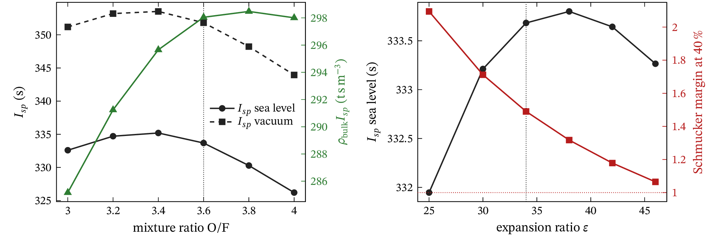

- Mixture ratio: Sea-level Isp peaks near O/F 3.4 (335.2 s), while bulk-density Isp keeps rising to 3.8. O/F 3.6 is a vehicle-level compromise. The wall-bias penalty grows with O/F because the gap to the wall O/F grows.
- Expansion ratio: Sea-level Isp is flat between ε 30 and 42 (333.2-333.8 s). Larger ε adds chamber mass (+22 kg from 34 to 38) and lowers the 40 %-throttle separation margin (1.49 at 34, 1.18 at 42). ε 34 is right for this mission.
- Chamber pressure: 250 and 300 bar close easily. 400 bar does not close at OPB 820 K and FPB 1,100 K: the ox turbine runs out of power first.
- Wall bias (figure 6): A wall O/F of 2.4 does not close the cycle, because the jacket dP rises too far. Wall O/F 1.6 gives large wall margin. The stream-tube model, however, cannot say whether a thin wall layer survives mixing down to the throat. Bias fractions below about 6 % need a film-decay model before I would trust them.

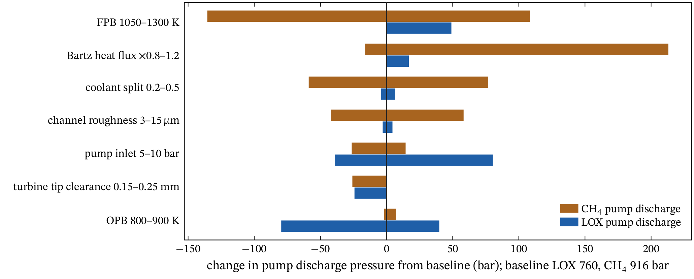

- Sensitivities (figure 5), as the change in CH4 pump discharge:
  - Bartz heat flux ×1.2: +213 bar; the hot wall also reaches 922 K. This is the largest model uncertainty.
  - FPB temperature 1,050-1,300 K: +108 to −135 bar.
  - Channel roughness 3-15 µm: −42 to +58 bar.
  - Coolant split: up to −59 bar.
  - Turbine tip clearance: a 0.40 mm clearance makes the cycle infeasible.
  - Pump inlet pressure 6 → 10 bar: shaft speed 15,700 → 23,100 rpm, LOX turbopump envelope radius 351 → 289 mm.

## 8. Improvements without much added complexity

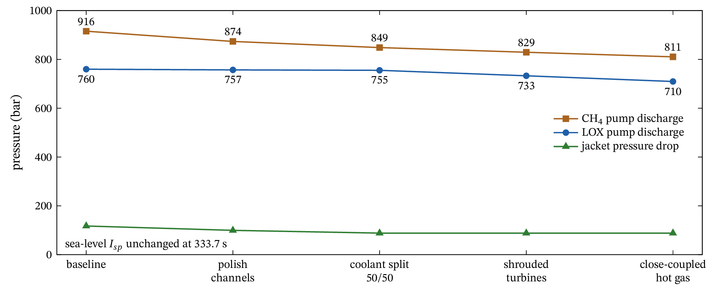

| Step (cumulative) | How | LOX / CH4 pump discharge |
|---|---|---|
| Baseline | | 760 / 916 bar |
| Polish AM channels, Ra 8 → 3 µm | abrasive-flow finish; process change only | 757 / 874 |
| Coolant split 30/70 → 50/50 | resize the circuit-B orifice | 755 / 849 |
| Shrouded turbine rotors, clearance 0.25 → 0.15 mm | integral tip shroud on the AM blisk | 733 / 829 |
| Close-coupled hot-gas path, dP 3 → 1.5 % pc | collector welded to the injector inlet; one flange pair less per side | 710 / 811 |

Sea-level Isp stays at 333.7 s throughout. The lower pressures thin the walls, flanges and bolts, and the CAD of the improved engine (`cad/output_improved/`) is 72 kg lighter (1,796 vs 1,868 kg).

Spending the margin on chamber pressure buys little. With the pump pressures capped at the baseline values, the improved engine reaches about 355-358 bar (+0.3 s), because the LOX shaft sits near its peak-power point. The margin is better used for life and robustness.

Options that each have a real cost, evaluated on top of the chain:

| Option | Effect | Cost |
|---|---|---|
| OPB 820 → 860 K | LOX discharge 710 → 676 bar | ox-rich alloy qualification at 860 K |
| Pump inlet 6 → 8 bar | LOX shaft 15,730 → 19,560 rpm, TPA envelope radius 346 → 309 mm, LOX discharge 695 bar | higher tank pressure on the vehicle |
| Wall O/F 2.0 → 1.8, share 8 → 7 % | jacket dP 88 → 50 bar, CH4 discharge 811 → 738 bar | −0.5 s Isp |

The CAD roll-up (figure 9) shows where the remaining gap to Raptor 3 sits: ducts, valves and flanges about 455 kg, and coolant manifolds plus jumpers about 140 kg. The cycle physics is close to Raptor's. The difference is integration: manifolds built into the AM chamber wall, turbine exhausts flowing straight into the injector, and fewer bolted joints. That is the next iteration's job, and PicoGK-style geometry is the right tool for it.

## 9. CAD assembly

`cad/build_engine.py` builds the assembly from `results/design.json` in FreeCAD 1.1 (headless). `cad/open_in_gui.py` opens it with material colours.


- Tree: `MFE280_Engine` holds Thrust_Chamber, Injector_Head, Gimbal, LOX_Turbopump, CH4_Turbopump (both as App::Part with their own placement), Plumbing and Instrumentation. There are 178 objects, each with Material, Quantity and Note properties.
- Outputs: `cad/output/MFE280.FCStd`, `MFE280_assembly.step`, one STEP per sub-assembly, `MFE280_hot_gas_volume.step` (gas-side solid for CFD), `bom.csv`, `mass_summary.json`, `layout.json` and `clash_report.json`.
- Bolted joints (sized in `ffsc/structures.py`):

| Joint | Bolts | BCD |
|---|---|---|
| Injector / chamber | 22 x M27 Inconel 718 | 529 mm |
| Nozzle joint (ε 12) | 40 x M12 A286 | 912 mm |
| LOX / CH4 inlet (vehicle interface) | 16 / 14 x M10 A286 | |
| LOX discharge, FPB feed | 14 x M16 / 14 x M14 Inconel 718 | |
| CH4 discharge | 10 x M20 Inconel 718 | |
| Ox / fuel hot gas | 22 / 20 x M12 Inconel 718 | |
| Nozzle return | 10 x M12 | |
| Ox / fuel cross-feeds; coolant jumpers (4) | 8 / 6 x M8; 8 x M8 per jumper | |
| Igniters | 4 x M6 | |
| Gimbal pad | 12 x M16 | |
| Turbopump casings (inlet, bearing housings, CH4 volute cover) | M10 tapped; 12 x M30 tapped on the CH4 volute cover | |
| LOX volute cover, ox turbine housing, CH4 turbine housing | welded | |

  374 bolts and screws in total. Through bolts carry ISO 4032 nuts and two ISO 7089 washers; casing screws go into tapped holes.
- Clash check: pairwise boolean intersection of all 178 solids, fasteners and turbopump internals included, after a bounding-box prefilter. Each overlap solid counts only if its centroid lies inside both parts, which removes OCC sliver artifacts from touching faces. A short allowlist covers contacts that exist by design: blades rooted 0.3-0.5 mm into their hub or shroud, bosses welded to the preburner shell, the collector-to-housing weld, casing screws in their (unmodelled) tapped holes, and each bolt stack in its own flange pair. Result: 0 clashes for the baseline and for the improved engine. Welded attachments (manifolds, jumpers, dome, bosses) are trimmed to their parent surfaces.
- Level of detail: layout level. Impellers have 6 + 6 backswept blades, inducers have 3 helical blades, and the turbines have full rotor and stator rows. Cooling channels are not in the FreeCAD solids; they are in the PicoGK model.

## 10. Computational engineering with PicoGK

The cooling model's sized channel geometry (`results/cooling_profile.csv`: count, width, rib, height, hot-wall and closeout thickness per station) drives a voxel model of the GRCop-42 chamber built with PicoGK 2.3. The program (`picogk/RegenChamber`, details in `picogk/README.md`) evaluates a signed-distance field of liner, ribs and closeout directly from the 1-D stations, so the printable geometry comes straight from the physics output.

At a voxel size that resolves the 0.6 mm hot wall, the full 0.41 m chamber needs about 17 GB even at 0.3 mm, so the build covers a periodic 7.5° sector with 8 base channels (16 after the bifurcation). It runs the full copper length, injector face to the ε 12 joint, and is built at two voxel sizes as a resolution check:

| | 0.15 mm | 0.10 mm |
|---|---|---|
| Voxel volume vs analytic 419,173 mm³ | +0.08 % | −0.10 % |
| Surface mesh volume | +0.07 % | +0.03 % |
| Watertight (bad edges) | yes (0) | yes (0) |
| Hot wall / channel width measured on the mesh | 0.600 / 1.000 mm | 0.600 / 1.000 mm |
| Channels found at z = 60 mm, throat, 900 mm | 8, 8, 16 | 8, 8, 16 |
| Peak memory, total time | 4.7 GB, 171 s | 10.6 GB, 524 s |

The mesh volume error falls at about second order between the two sizes. The coarse mesh has genus 23 against an ideal 16: the first millimetres of each splitter knife edge are thinner than one 0.15 mm voxel and come out perforated. Use 0.10 mm for anything that will be printed or meshed.

Building the solid exposed a geometry problem the 1-D model could not show. At the 384 → 768 bifurcation the new splitter rib (1.017 mm) is wider than the 1.0 mm channel it splits, so an abrupt switch would block the flow. The voxel model therefore uses a 10 mm blend in which the splitter grows from a knife edge and no channel exceeds 1.0 mm. The cooling model should get the same blend, with its own pressure-loss term, in the next iteration.

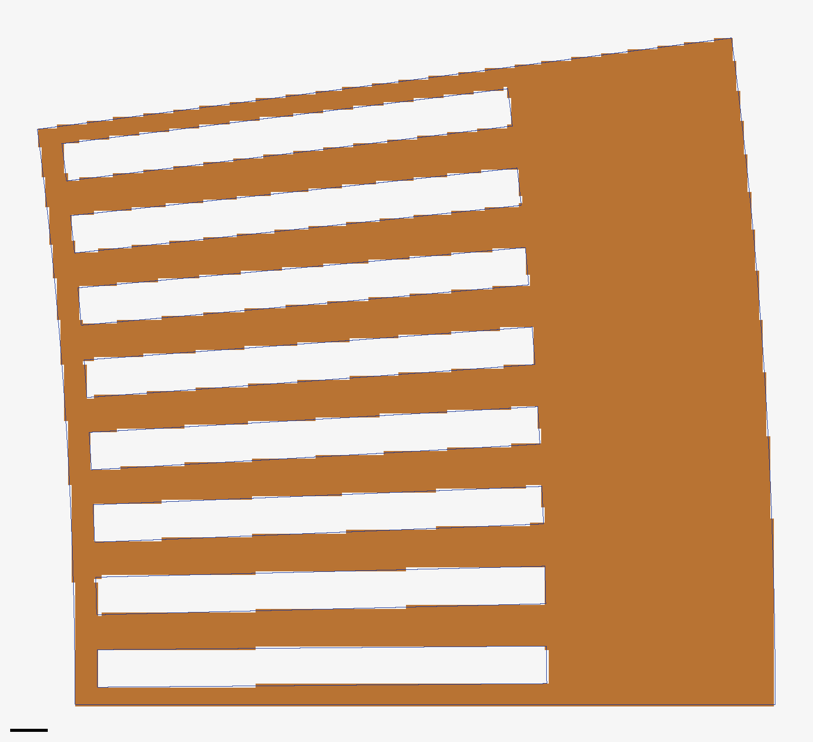

Integrating the coolant manifolds and the hot-gas inlet into this geometry (section 8) is the natural next step.

## 11. P&ID and drawings

The drawing sets follow my EM-P220 drawing standard (same sheet, title block and lettering, without the university logo). They are generated as DXF from Python (`drawings/src/`, ezdxf) and passed through AutoCAD 2025 in batch mode (`accoreconsole`). AutoCAD saves each sheet as DWG (2018 format) and plots it to PDF with `monochrome.ctb` and object lineweights, so the PDFs come from the same plot path as a manual AutoCAD plot.

The template (`drawings/src/sheet.py`) is shared by both sets:

- ISO 5457 sheet with filing margin, 50 mm zones counted from the frame centre, and centring marks;
- ISO 7200 title block, 180 x 47 mm, with the same fields and layout as my EM-P220 block;
- a two-row standards strip above the title block;
- ISO 3098 type B lettering (ISOCPEUR);
- ISO 128-20 line widths (0.7 / 0.5 / 0.25 / 0.18 mm) through layer lineweights, with ISO dashed and chain line types;
- ISO 128-50 hatching and ISO 129-1 dimensions;
- the ISO 5456-2 third-angle symbol in place of the logo, with the circles next to the small end of the cone.

P&ID set (`drawings/MFE280-PID-SET.pdf`, 5 sheets, built by `make_pid_set.py`):

| Sheet | Content |
|---|---|
| PID-000 (A3) | Legend: ISO 10628-2 symbol forms, ANSI/ISA-5.1 function symbols and the identification letters used, fluid codes, piping classes with design pressure = 1.2 x MEOP |
| PID-001 (A2) | Engine P&ID: both propellant trains, kick stage, cross-feeds, regen circuits A/B with FO-301, hot-gas lines, GOX and GCH4 autogenous pressurant taps, chill-down bleeds, GHe purge with regulator, relief and check valves, torch igniters, and the control loops PIC-101 (thrust through MOV/MFV), TIC-203 (OPB temperature through OPFV) and TIC-303 (FPB temperature through FPOV), plus shutdown interlock UZ-100 |
| PID-002 (A3) | Line list |
| PID-003 (A3) | Equipment and valve lists |
| PID-004 (A3) | Instrument index |

Every tag, line designation (inside diameter, fluid, line number, piping class) and number comes from one tag database (`drawings/src/pid_data.py`), which itself reads `results/design.json`. The diagram and the registers therefore cannot disagree.

The mechanical set (`drawings/MFE280-DWG-SET.pdf`, built by `make_mech_drawings.py`) has six A3 sheets. `drawings/src/extract_views.py` runs inside FreeCAD and writes exact hidden-line-removed outlines and cut faces of the model to `drawings/build/`. Every outline on the sheets is therefore the model itself, and all dimensions and tables read `results/design.json`.

| Sheet | Content |
|---|---|
| GA-001 | General arrangement: front, side and top views at 1:25, envelope, list of material by sub-assembly, key data |
| TCA-002 | Thrust chamber section A-A at 1:10, detail B of the injector/chamber flange, detail C of the throat channels at 10:1, channel geometry table |
| INJ-003 | Injector seen from the chamber with all 173 elements, section B-B, detail D of one coaxial element, ring table |
| TPO-004, TPF-005 | LOX and CH4 turbopumps with their preburners: sections E-E and F-F at 1:5, list of material, pump, turbine and preburner data |
| JNT-006 | Schedule of all 22 joints, with the welded ones and the reason for each, and a typical flanged joint |

Drawing the sections found model defects that the clash check of that time had missed, because it did not yet include fasteners or turbopump internals: an inducer hub smaller than the shaft, impellers without a bore, a stator ring overlapping its housing, CH4 turbine-housing bolts that no tool could reach under the exhaust collector, bosses wider than their mating pipes, and a mis-sized FPB feed duct. I fixed all of them in the model, extended the clash check, and regenerated the set from the corrected model.

## 12. CFD

`cfd/make_case.py` writes an OpenFOAM v2306 (ESI) case, `cfd/cases/mfe280_sl_axi`, from `results/contour.csv` and `design.json`; with `--results results/iterations/I2-C` it writes the I2-C case, `cfd/cases/mfe280_I2C_sl_axi`. Details, run commands and the run history are in `cfd/README.md`.

Domain:

- a 5° axisymmetric wedge of the hot-gas path, from the chamber cylinder through the bell;
- the sea-level plume region, 12 exit diameters downstream and 8 exit radii outward, with a 20 mm nozzle lip.

Mesh: 9-block blockMesh, 248,526 cells for I1 and 223,827 for I2-C. checkMesh passes, with maximum non-orthogonality 31° and skewness 0.91. First cells are sized for y+ ≈ 50 (20 µm at the throat).

Solver set-up:

- rhoCentralFoam with Kurganov fluxes, k-ω SST, and local time stepping to steady state.
- Inlet: total pressure 350 bar and total temperature 3,785 K (I1), 400 bar and 3,804 K (I2-C).
- Walls are adiabatic. The cooling-profile wall temperature is an option.

Gas: a single equivalent gas with γ = 1.125, cp = 3,217 J/kg K and M = 23.26 kg/kmol. This γ reproduces the shifting-equilibrium exit pressure exactly. c* is within 0.22 % and sea-level Isp within 0.07 %, but exit static temperature is 9 % low. The true frozen chamber properties would give an exit pressure 21 % low, which matters for a separation study.

Thrust comes from nozzle-only runs. The exit flow is supersonic, so nothing in the plume reaches the exit plane, and these runs converged at 24,000 iterations. An implicit solver (HiSA) on the I1 nozzle is the cross-check. The plume runs then went to 20,000 iterations. Every failure on the way was at the far-field boundary, under the plume's starting vortex:

- a total-pressure inflow (run 1) and a non-reflecting pressure (run 2) let the side-boundary pressure fall towards vacuum;
- a fixed static pressure with a blunt starting column (run 3) reflected the start-up shock as an expansion;
- in I1 run 4, a supersonic radial stream from the vortex ring left through the fixed-pressure side face, at iterations 7,969 and 8,948.

I1 finished with a characteristic switch on that face: ambient pressure unless the adjacent cell flows out supersonically, zero gradient if it does. The switch was needed only while the starting vortex passed. In every save checked from iteration 11,000 on, all faces held ambient pressure, so the final I1 solution has the same boundary as I2-C.

| Result (mean of the last 2,000 iterations) | I1 | I2-C |
|---|---|---|
| Discharge coefficient (CFD / ideal 1-D mass flow) | 0.9937 | 0.9937 |
| Sea-level thrust, CFD / ideal 1-D (MN) | 2.764 / 2.816 | 2.763 / 2.814 |
| Sea-level Isp, CFD / ideal 1-D (s) | 343.3 / 347.6 | 345.9 / 350.1 |
| Vacuum Cf, CFD / ideal 1-D (the cycle model's η_Cf) | 0.983 | 0.983 |
| Bell wall pressure at the lip | 179 kPa | 200 kPa |

The nozzle efficiency the cycle model assumes, η_Cf = 0.98, holds: the CFD gives 0.983 for both iterations, with the loss in divergence and wall friction. The throat passes 0.63 % less than the 1-D flow (2-D sonic line and boundary layer); in the design this sits inside the delivered c*. HiSA agrees with rhoCentralFoam within 0.07 % in discharge coefficient and 0.12 % in vacuum Isp. The plume runs reproduce the nozzle-only exit plane within 0.002 % in thrust. The bell stays attached at sea level: the wall pressure falls to the lip with no plateau or rise, to 1.8 times ambient in I1 and 2.0 times in I2-C.

These values use the flat-face sector factor 2π / sin 5° = 72.0915. Earlier versions of this report used 72, which read mass flow, thrust and the Cf ratio about 0.13 % low (Cd 0.9924, Cf ratio 0.981). Vacuum Isp did not change.

The near plume is steady. Over the last three saves (I2-C: 16,000, 18,000 and 20,000; I1: 17,000, 18,000 and 20,000) the centreline Mach number agrees within 0.01 from the throat to x = 5.1 m in I2-C and to x = 4.75 m in I1. That covers the first two shock cells. Further downstream it has not settled. The shock cells move between saves, and the shear layer rolls up into large structures that convect downstream and radiate pressure waves into the ambient gas. Images of that region show one state of a moving pattern; averaging it would need a time-accurate restart.

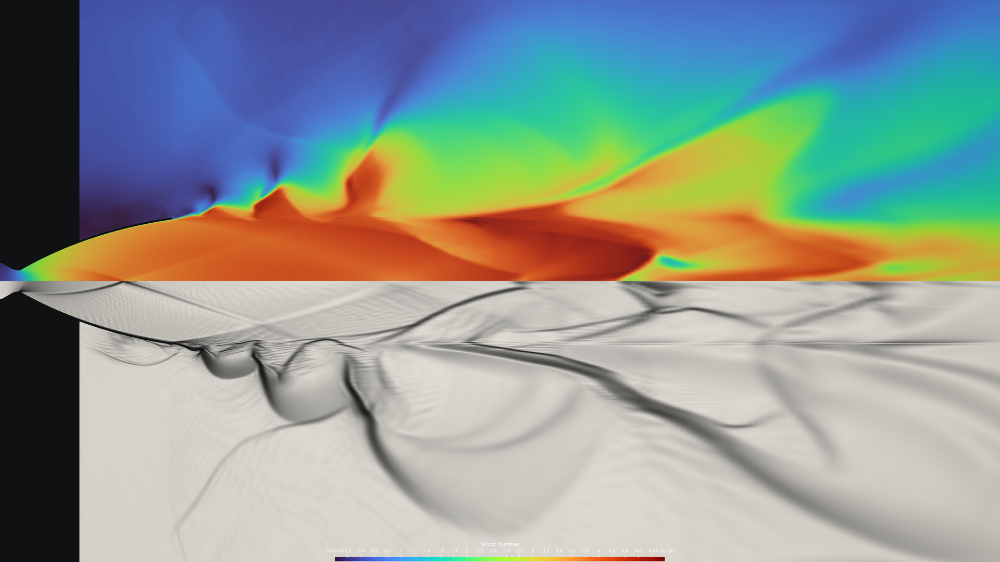

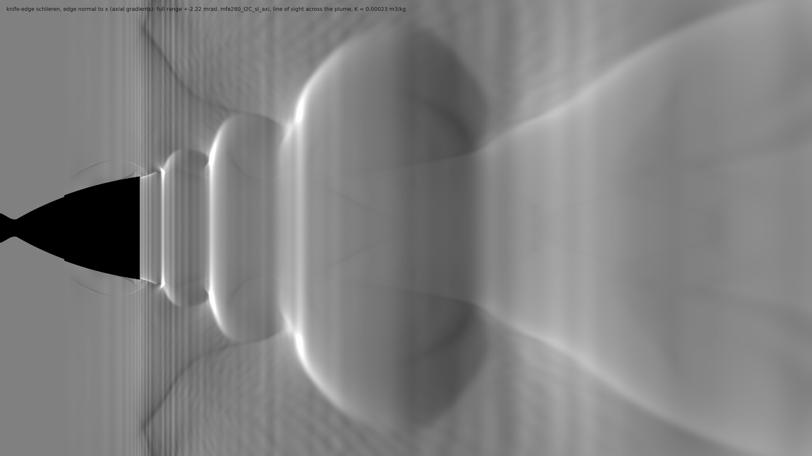

The image set in `figures/cfd/` (described in `cfd/README.md`, "Plume images") has field images, a path-traced cutaway, line-of-sight knife-edge schlieren and shadowgraph, and an optically thin H2O + CO2 emission image with its optical-depth map. The emission image is an upper bound: on the axis the Planck-mean optical depth is 4 to 12. Two checks remain: separation at 40 % throttle (`--pc-frac 0.4`) and a mesh study.

## 13. Iteration 2: design options

Iteration 1 is frozen as git tag `iter-1` (commit `3de37cf` on `main`). Iteration 2 work lives on the `iter-2` branch. Every candidate change goes into one register, `config/options.yaml`, with its physics basis, how it is evaluated, its technology readiness level (TRL) for this engine and a development-effort class. `scripts/run_options.py` evaluates each option against the iteration-1 improved engine (1,796 kg, thrust-to-weight 156), and `scripts/run_economics.py` adds its recurring and development cost (section 16).

Evaluation types:

- cycle: rerun the 0-D/1-D chain with new inputs;
- variant: a full design plus FreeCAD build (`scripts/build_variant.py`), so the mass comes from the CAD roll-up and the clash check covers it;
- bom: parts removed or resized in the iteration-1 bill of materials. This is an estimate until the option is modelled as geometry;
- calc: a dedicated calculation (bearing DN, boost pump, alternator, preburner mixing, plasma).

| ID | Option | Mass (kg) | T/W | LOX / CH4 pump (bar) | Unit cost (k$) | Development (M$) | TRL |
|---|---|---|---|---|---|---|---|
| C1 | Hybrid Si3N4 bearings, CH4 pump | - | - | - | +21 | 3.4 | 6 |
| C2 | Hydrostatic bearings, CH4 pump | - | - | - | +27 | 13.6 | 5 |
| C3 | SX fuel-turbine blades, FPB 1,200 K | - | - | +11 / −60 | +566 | 3.4 | 6 |
| C4 | Ox-rich hot section to 900 K | - | - | −58 / +6 | +123 | 40.8 | 4 |
| C5 | Two-stage turbines, η 0.87 | - | - | −41 / −36 | +43 | 3.4 | 7 |
| I1 | Welded hot-gas joints | −18 | 158 | - | −30 | 0.3 | 7 |
| I2 | Printed integral coolant manifolds (CAD-measured) | +21 | 154 | - | +12 | 3.4 | 6 |
| I3 | Welded duct joints after the pumps | −73 | 163 | - | −126 | 0.3 | 8 |
| I4 | Single-piece printed injector | 0 | 156 | - | −29 | 3.4 | 6 |
| I5 | Bimetallic chamber + nozzle, no ε 12 joint | −37 | 159 | - | −11 | 13.6 | 5 |
| K1 | Fuel-rich preburner residence time 4 → 8 ms (CAD-measured) | +27 | 154 | - | +33 | 0.3 | 7 |
| Y1 | Pump inlet 6 → 10 bar (CAD variant) | −157 | 171 | 691 / 800 | −142 | 0.3 | 8 |
| Y2 | pc 400 bar with C3-C5 and Y1 (CAD variant) | −180 | 173 | 786 / 951 | +560 | 40.8 | 4 |
| N1 | Plasma-assisted preburners | - | - | - | not viable | 40.8 | 2 |
| N2 | Laser or plasma start ignition | −3.5 | 156 | - | +65 | 3.4 | 5 |
| N3 | Battery-driven boost pumps | +291 to +689 | - | - | +162 | 13.6 | 5 |
| N4 | Turbine-shaft alternator, 150 kW | +30 | - | - | +34 | 3.4 | 5 |
| N5 | Lower OPB temperature spread (mixing) | - | - | −49 / +5 | 0 | 13.6 | 4 |

Mass and T/W are changes from, or values for, the improved engine. Costs are P50 for the hybrid build strategy.

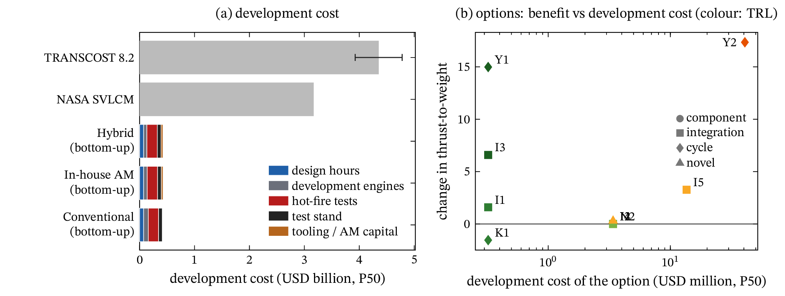

What the register shows:

- Welding the joints that are never opened (I1, I3) is the cheapest gain: 91 kg and 712 fasteners less in the estimate, 95 kg and 692 pieces in the I2-C build, for about $0.6M of development. The cost is serviceability: a valve then comes out by cutting, which is the production choice Raptor 3 made.
- The biggest single gain is the pump inlet pressure (Y1). Inducer cavitation sets the shaft speed, and 10 bar instead of 6 bar lets both turbopumps run about 50 % faster. In the CAD build the LOX turbopump drops by 103 kg and the CH4 turbopump by 44 kg. The extra pressure is a vehicle requirement (tank pressure), so it needs a vehicle-level trade.
- The bearings couple to the speed. The CH4 shaft already runs at 2.27 million DN in the improved engine, above the 1.8 million usual for steel cryogenic bearings, so C1 is needed anyway. With a 10 bar inlet the CH4 shaft reaches 3.09 million DN, past hybrid bearings too (3.0), so Y1 brings C2 (hydrostatic bearings) with it.
- Electric boost pumps (N3) do not pay. Raising the inlet by 4 bar takes 578 kW of shaft power, or 628 kW electric. Motors, inverters, pumps and the power source add 291 kg (shaft alternator) to 689 kg (Li-ion pack), against the 157 kg that Y1 saves.
- A turbine-shaft alternator (N4) supplies 150 kW for valve actuators, igniters and electronics at about 30 kg, against 125 kg of Li-ion pack for the same 170 s burn.
- Better mixing in the ox-rich preburner (N5) is worth nearly as much as a new alloy. The turbine metal sees the hottest streak. With a pattern factor of 0.20, the 820 K mean gives a 964 K peak. Halving the pattern factor at the same peak allows a 885 K mean and lowers the LOX pump discharge by 49 bar. Option C4 gets 58 bar by qualifying a new hot-section alloy to 900 K, which is far harder.

`config/iterations.yaml` combines the options into three candidates for iteration 2. `scripts/run_iterations.py` adds up their deltas and writes `docs/ITERATIONS.md`:

| Candidate | Options | Mass (kg) | T/W | Isp SL (s) | Unit cost T1 ($M) | Development ($B) | Lowest TRL |
|---|---|---|---|---|---|---|---|
| I2-A integrate and weld | K1 I1 I3 I2 I4 N2 C1 N5 | 1,749 | 160 | 333.7 | 3.31 | 0.46 | 4 |
| I2-B + 10 bar inlet | I2-A + Y1 C2 | 1,592 | 176 | 333.7 | 3.20 | 0.47 | 4 |
| I2-C + 400 bar | I2-B with Y2 | 1,570 | 178 | 336.2 | 3.90 | 0.51 | 4 |
| I2-C as built (section 17) | | 1,576 | 178 | 336.2 | 3.94 | 0.51 | 4 |
| Raptor 3 (public) | | 1,525 | 184 | | | | |

The deltas are added linearly, so the candidates are estimates until each one is built as its own CAD variant. An earlier version of this table credited the integral manifolds with −55 kg and the one-piece injector with −15 kg; the I2-C build showed both were wrong (section 17), and the estimates now use the measured factors. The I2-C estimate (1,570 kg) and the built engine (1,576 kg) now agree. The modelled mass still leaves out the harness, controller and purge lines, so a T/W of 178 on paper is not a like-for-like comparison with Raptor 3's 184. The remaining gap is integration and inlet pressure.

## 14. Higher pump pressures and chamber pressure

`scripts/run_pc_ceiling.py` sweeps the chamber pressure for the improved engine and for each enabling option. A point counts as feasible when the power balance closes, the hot wall stays at its 880 K design value, and neither pump exceeds an assumed 1,000 bar discharge limit (housings, seals and ducts).

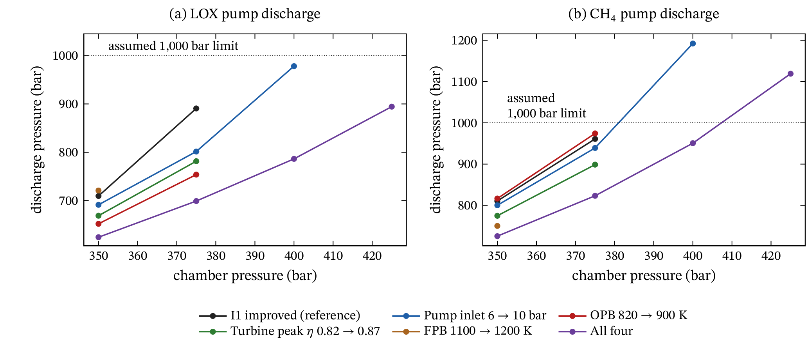

| Enabler | pc ceiling (bar) | Limit reached |
|---|---|---|
| Improved engine | 375 | LOX shaft 11.4 MW short at 400 bar |
| Pump inlet 10 bar | 375 | CH4 pump 1,192 bar at 400 bar |
| OPB 900 K | 375 | CH4 shaft 4.2 MW short at 400 bar |
| Turbine η 0.87 | 375 | LOX shaft 6.2 MW short at 400 bar |
| FPB 1,200 K | 350 | LOX shaft 4.9 MW short at 375 bar |
| All four | 400 | CH4 pump 1,119 bar at 425 bar |

No single enabler moves the ceiling, because the two shafts are coupled through the cross-feeds. A hotter OPB needs more methane, which the CH4 turbine then lacks. A hotter FPB needs more oxygen through the kick stage, which the LOX turbine then lacks. All four together reach 400 bar with the pumps at 786 and 951 bar. Sea-level Isp rises by 2.6 s to 336.2 s. The CAD variant at 400 bar (`I2_uprate400`) weighs 1,616 kg, 180 kg less than the improved engine:

| Sub-assembly | Change at 400 bar (kg) | Change with 10 bar inlet only (kg) |
|---|---|---|
| Thrust chamber | −27 | −2 |
| Injector head | −18 | 0 |
| LOX turbopump | −113 | −103 |
| CH4 turbopump | −49 | −44 |
| Plumbing | +28 | −9 |

Most of the saving comes from the faster turbopumps, which the 10 bar inlet already gives at 350 bar. Going from 350 to 400 bar adds only 22 kg of saving and 2.6 s of Isp, for the hardest development item in the register (C4, an ox-rich alloy at 900 K, TRL 4). Higher chamber pressure is therefore a later step. The inlet pressure and integration come first.

Both variants first showed two layout clashes: the CH4 inlet-housing screws hit the volute-cover bolts, and the TVC lugs touched the injector bolt heads. I added a sizing rule to `ffsc/design.py`: the volute-cover bolt circle has to clear the inlet-housing washers by 3 mm. The lugs now start above the bolt heads. Neither change affects iteration 1, and both variants build with 0 clashes.

## 15. Plasma-assisted combustion and the power-source question

The idea: use non-equilibrium plasma (nanosecond repetitively pulsed, NRP, discharges) to assist combustion, and treat its electrical supply as a power source of whatever energy density the job needs, whether next-generation batteries or a small reactor. At 1 atm, NRP discharges make O atoms and heat that extend lean blow-off limits by up to 70 % for less than 1 % of the flame power. The question is whether any of that survives in an engine whose preburners run at 620-630 bar, and what power source it would take.

### 15.1 Model

`ffsc/plasma.py`, run by `scripts/run_pac.py`:

- Each combustor is a perfectly stirred reactor (PSR) in Cantera with GRI-Mech 3.0, at its design pressure and global O/F.
- The inlet enthalpy is the real one from the cycle model: liquid LOX plus methane warmed in the cooling jacket. Liquid injection cannot be written as a gas inlet temperature (for the LOX-rich case the enthalpy lies below that of the ideal gas at 0 K), so the inlet is gas at 300 K and a heat sink proportional to the mass flow removes the difference. The reactor then finds its own exit temperature from the kinetics.
- The plasma deposits a specific energy e_p in the inlet. A share α_O makes O atoms at ε_O eV each and the rest heats the gas, so the total enthalpy rises by exactly e_p. The only measured branching is for air: about 35 % to O2 dissociation in an NRP spark (Rusterholtz et al. 2013), which implies 7.3 eV per O atom. That is the nominal case. The optimistic case is α_O = 0.5 at 4.2 eV per atom.
- tau_ext, the shortest residence time at which the reactor still burns, comes from continuation down the burning branch. Every step starts from the last converged burning state and shrinks near the turning point, so the result does not depend on how the search jumps.
- The breakdown voltage of a gap is V = (E/N)_b N d, with (E/N)_b ≈ 100 Td and N = p / k_B T.

A first version anchored the heat sink to chemical equilibrium at the design preburner temperature. For the fuel-rich preburner that quietly added about 540 kJ/kg, because equilibrium at 631 bar includes endothermic methane reforming, which the cycle's frozen complete-combustion model does not. That version gave a 0.5 ms extinction time and a large margin. Anchoring to the real inlet enthalpy changes the answer, and everything below uses it.

### 15.2 What the kinetics say

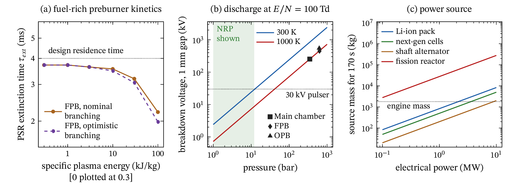

| Combustor | Result |
|---|---|
| Main chamber, 350 bar | Extinction at 21 ns against a 1.07 ms residence time, a margin of about 52,000. The main chamber is mixing-limited, not kinetics-limited. |
| Ox-rich preburner, 621 bar | A premixed reactor at 820 K has no burning branch even at 1 s, with or without plasma up to 300 kJ/kg (187 MW). The homogeneous ignition delay at 820 K is 59 ms, against a 3 ms residence time. |
| Fuel-rich preburner, 631 bar | Burns near 1,000-1,020 K and goes out at 3.72 ms, against a 4 ms design residence time: a margin of 1.08. The ignition delay at 1,000 K is 4.3 ms. |

Both preburners therefore only work as staged diffusion flames: near-stoichiometric zones that burn hot and fast, then dilution to the turbine temperature. That is how real FFSC preburners work. The cycle model only assumed a residence time (3 ms and 4 ms) and never checked it against the chemistry.

Plasma moves the fuel-rich extinction time only at megawatt power:

| e_p (kJ/kg) | Plasma power (MW) | tau_ext, nominal / optimistic (ms) |
|---|---|---|
| 0 | 0 | 3.72 / 3.72 |
| 10 | 2.2 | 3.56 / 3.48 |
| 30 | 6.5 | 3.19 / 3.06 |
| 100 | 21.8 | 2.21 / 1.98 |

The cheap fix is geometric: an 8 ms residence time (option K1) gives a margin of 2.15. Doubling the volume doubles the shell (pressure-vessel mass scales with p V), which adds 18 kg.

The same check exposes a cycle-model risk. At its design O/F, the fuel-rich preburner burns near 1,000 K in the reactor, not the 1,100 K that frozen complete combustion gives. If the real preburner delivers 1,000 K, the CH4 pump discharge rises by 131 bar (811 to 942 bar). The fuel-side pressure margin therefore depends on preburner chemistry that the cycle model simplifies. A kinetics-coupled preburner model is the first physics task of iteration 2.

### 15.3 The discharge itself

| Location | Breakdown, 1 mm gap |
|---|---|
| Start transient, 5 bar, 300 K | 12 kV |
| Highest pressure with a shown NRP benefit, 12 bar, 300 K | 29 kV |
| Main chamber, 350 bar, 1,000 K | 254 kV |
| Fuel-rich preburner, 631 bar, 1,019 K | 448 kV |
| Ox-rich preburner, 621 bar, 820 K | 549 kV |

A 30 kV pulser breaks down a 1 mm gap only below about 12 bar. At preburner pressures, gas breakdown needs about half a megavolt per millimetre, far beyond the tens of kV per millimetre that ceramic insulators hold. At this density, quenching and relaxation take picoseconds to a nanosecond, so the deposited energy turns into heat almost at once, and the discharge tends to start at electrode micro-protrusions and become a thermal arc. That removes the non-equilibrium chemistry that makes NRP useful. Laser breakdown behaves the other way, with a threshold that falls as pressure rises, and laser ignition of LOX/methane injectors has been shown.

### 15.4 What the power source would need

The useful form of the power-source question is: how much specific power and energy must the source have for the concept to pay for its own mass? `scripts/run_pac.py` computes this for each plasma or electric concept against the mass it saves or the cheaper alternative it competes with:

| Concept | Power | Mass budget | Source must reach | Today |
|---|---|---|---|---|
| Plasma in the FPB, extinction time 3.7 → 2.2 ms | 21.8 MW, 170 s | 18 kg (option K1 does the same) | 1,210 kW/kg and 57,000 Wh/kg | nothing comes close |
| Electric drive on the LOX shaft, 375 → 400 bar without the C3-C5 enablers | 11.4 MW, 170 s | 355 kg (the whole LOX turbopump) | 32 kW/kg and 1,520 Wh/kg | 16-27 times beyond batteries in power, 6-9 times in energy |
| Electric boost pumps, inlet 6 → 10 bar | 0.63 MW, 170 s | none: motors and pumps already use up the 157 kg saved | impossible at any power density | - |
| Plasma or laser start ignition | 4 kW, about 5 s | 3.4 kg (the torch igniters) | 1.2 kW/kg, 1.6 Wh/kg | any battery |

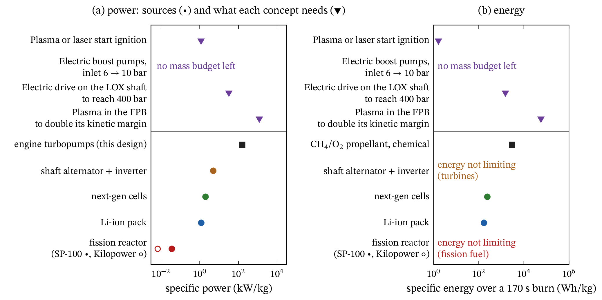

The reference points:

- Li-ion pack: 1.2 kW/kg and 170 Wh/kg (Formula E Gen3 pack level).
- Next-generation cells: about 2 kW/kg and 240 Wh/kg at pack level.
- High-speed alternator with SiC inverter: about 5 kW/kg. It converts turbine shaft power, so energy is never the limit.
- Fission reactor: 0.036 kW/kg (SP-100) or 0.0067 kW/kg (Kilopower), 30 to 180 times heavier than a Li-ion pack for the same power. 1 MW would need about 28 t.
- This engine's own turbopumps: 88.5 MW of turbine power for 563 kg, or 157 kW/kg. The propellant carries about 3,000 Wh/kg of chemical energy.

The turbines are already the best power source on the vehicle: about 100 times denser in power than a battery and about 4,000 times denser than a reactor. Electrical power on this engine is therefore worth spending only on loads of tens to hundreds of kilowatts, and it should come from a shaft alternator (option N4). Plasma is worth keeping for ignition at low pressure (option N2), where it removes both torch igniters with their GOX/GCH4 taps and valves for a few kilowatts.

### 15.5 Where the novelty lands

The plasma study turned up two improvements that need no plasma at all:

- K1: a fuel-rich preburner sized from its kinetics rather than an assumed residence time.
- N5: a mixing-optimised ox-rich injector that lowers the temperature spread at the turbine. This gives the uniformity that plasma was meant to give, and is worth 49 bar of LOX pump pressure.

The novel part of the idea that survives the physics is electric start ignition plus an engine-driven electrical bus. An all-electric engine without hydraulic or pneumatic actuation (electromechanical valves, laser ignition, shaft alternator) is a real design simplification, and the numbers above show its electrical loads are small enough to carry.

## 16. Economics

`ffsc/economics.py` prices the engine bottom-up from the CAD bill of materials. Each of the 178 BOM lines falls into one of 23 component groups in `config/components.yaml`. Every group has a route for each build strategy (L-PBF, laser-wire DED, machined forging, vacuum casting, fabricated tube, COTS and so on), and `config/costs.yaml` holds the rates as triangular [low, nominal, high] inputs. A Monte Carlo with 4,000 samples draws each input once per sample, so every part in a sample sees the same shop rate or powder price. Sources for the rates are in section 18. Values without a source are marked "assumed" in the file.

Three build strategies:

- conventional: buy to print from suppliers with a 15-35 % margin, COTS wherever a catalogue part exists, conventional processes (milled channels with electroformed or brazed closeouts, castings, forgings);
- in-house AM: vertically integrated, with L-PBF and DED wherever they fit, custom valves made in-house, and castings, forged rings and igniters still bought;
- hybrid: the cheaper of the two routes for each group.

Recurring cost adds inspection (8 %), assembly hours per part, bolted joint and weld, engine integration and one acceptance hot fire. Learning curves follow NASA CEH practice: 85 % for assembly, 90 % for made parts, 87 % for COTS.

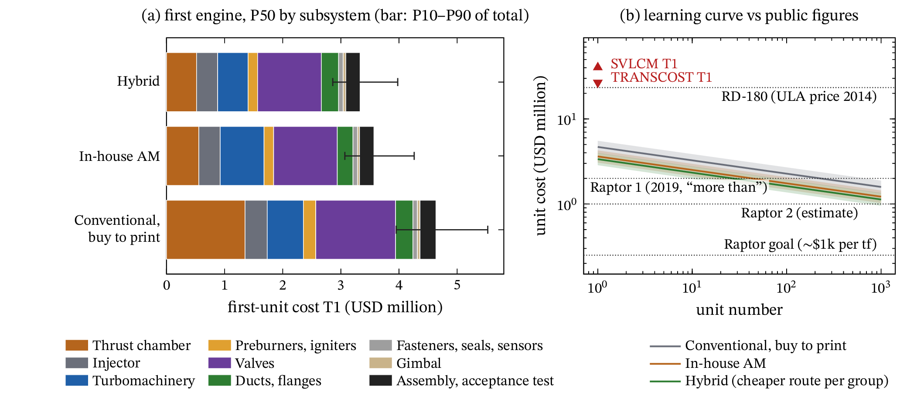

| | Conventional | In-house AM | Hybrid |
|---|---|---|---|
| First unit T1, P10 / P50 / P90 ($M) | 3.95 / 4.68 / 5.53 | 3.07 / 3.62 / 4.26 | 2.86 / 3.37 / 3.98 |
| Unit 100 / unit 1,000, P50 ($M) | 2.27 / 1.59 | 1.75 / 1.22 | 1.62 / 1.13 |
| Average of the first 100 ($M) | 2.67 | 2.06 | 1.91 |
| COTS share of T1 cost | 2.2 % | 2.8 % | 3.0 % |
| Development, bottom-up, P50 ($B) | 0.43 | 0.43 | 0.43 |

COTS covers 82 of the 178 BOM lines and 1,301 of the 1,974 pieces (fasteners, seals, bearings and sensors), but only about 3 % of the cost. The cost sits in parts nobody sells: the four main valves alone are $1.1-1.4M of the first unit. No catalogue valve combines 700-920 bar with a 100-160 mm bore at cryogenic temperature (the largest COTS cryogenic ball valves are rated near 20 bar). In-house valve development is therefore the largest single cost lever, which matches what the vertically integrated engine programmes did.

AM does not win everywhere (`docs/COMPONENT_SELECTION.md`). It wins clearly for the GRCop-42 chamber ($249k against $685k for a milled and electroformed liner), the DED nozzle ($141k against $539k), the shrouded impellers, the preburner heads and the injector posts. Casting stays cheaper for the pump housings, turbine housings, exhaust collectors and turbine blisks, and machining from forgings for the injector body. The hybrid strategy keeps both.

Development cost, P50:

- bottom-up, about $0.43B: 450,000 design hours, 25 development engines, 500 hot fires at $0.3M each, a $60M test stand, and AM capital or tooling;
- TRANSCOST 8.2: 277 M^0.48 f1 f2 f3 work-years at $390k, which gives $4.35B (P10-P90 $3.9-4.8B, f1 = 1.3);
- NASA SVLCM: $3.17B.

The top-down relations are fitted to government-funded engine programmes. Their first-unit cost ($27-41M) is of the same order as the RD-180 price ($23.4M) and far below the RS-25 restart ($104.5M), but 10-40 times the bottom-up figure and the public Raptor numbers (more than $2M for Raptor 1 in 2019, about $1M estimated for Raptor 2, a stated goal near $250k). The bottom-up model lands between them: about $1.1-1.6M at unit 1,000. Reaching the Raptor goal would need the integration options, in-house valves and a much higher production rate than the learning curve alone gives.


## 17. Iteration 2 build: I2-C

I2-C is the first built iteration (`config/iterations.yaml`, `builds:`). `scripts/build_iteration.py I2-C` applies the cycle overrides to the improved configuration, writes `results/iterations/I2-C/`, and builds the full CAD with STEP export into `cad/iterations/I2-C/`. The integration options are switches in `cad/build_engine.py`, all off by default; a rebuild with no switches reproduces the iteration-1 improved engine exactly (1,795.8 kg).

| Option | How it is modelled |
|---|---|
| Y2 (with C3, C4, C5, Y1) | pc 400 bar, pump inlets 10 bar, OPB 900 K mean, FPB 1,200 K, turbine peak η 0.87 |
| N5 | pattern factor 0.10, so the 900 K OPB mean has a 980 K peak, 16 K above iteration 1's 964 K peak |
| K1 | fuel-rich preburner sized for 8 ms residence time (13.6 L) |
| I1, I3 | 18 flange pairs (two hot-gas joints, six duct runs) replaced by butt welds; the hot-gas joints get a short welded spool across the old flange gap; vehicle interfaces stay bolted |
| I2 | coolant manifolds as D-section shells printed onto the jacket, at the same flow area as the round tubes (arc radius √2 times larger) |
| I4 | injector body, faceplate, 173 posts and interpropellant plate as one L-PBF part |
| N2 | laser spark-plug heads (28 mm) in window ports in place of the torch igniters |
| C1, C2 | LOX bearings M50/Si3N4 hybrid (1.9 million DN at 400 bar); CH4 bearings hydrostatic journal sleeves with 0.08 mm clearance and six supply orifices (3.1 million DN) |

| | I1 (frozen) | 400 bar variant, iteration-1 layout | I2-C built |
|---|---|---|---|
| Modelled mass (kg) | 1,868 | 1,616 | 1,576 |
| Thrust-to-weight | 150 | 173 | 178 |
| Isp sea level / vacuum (s) | 333.7 / 351.8 | 336.2 / 352.1 | 336.2 / 352.1 |
| Throat / exit diameter (mm) | 235 / 1,370 | 219 / 1,277 | 219 / 1,277 |
| Envelope x / y / z (mm) | 2,240 / 1,617 / 3,360 | 2,013 / 1,551 / 3,144 | 2,013 / 1,508 / 3,124 |
| BOM lines / pieces | 178 / 1,974 | 176 / 1,813 | 131 / 946 |
| Clashes | 0 | 0 | 0 |
| First unit, hybrid build, P50 ($M) | 3.37 (improved) | 3.19 (hardware only) | 3.94 |

`scripts/attribute_iteration.py` compares I2-C with the 400 bar variant group by group, so every change below is CAD-measured:

| Option | Mass change (kg) | BOM lines | Pieces |
|---|---|---|---|
| I1, I3 welded joints | −94.7 | −42 | −692 |
| I4 one-piece injector | 0.0 | −3 | −175 |
| N2 laser ignition | −1.8 | 0 | 0 |
| C1, C2 bearings | +0.3 | 0 | 0 |
| K1 larger fuel-rich preburner | +29.4 | 0 | 0 |
| I2 integral manifolds | +22.6 | 0 | 0 |
| Knock-on (jumpers, turbine housing) | +3.8 | 0 | 0 |

The build corrected two of my estimates. The integral manifolds were credited with a 45 % mass saving because the D-section shares the jacket closeout as one wall. At the same flow area and hoop stress that saving does not exist: a thin pressure shell weighs about p V / σ, and the D-section's larger arc radius needs a proportionally thicker wall. The CAD shows +17 %, from longer port stubs and from more than half of the torus remaining where the nozzle wall slopes. I2 is now a manufacturing choice (one print, no manifold welds to inspect), not a mass one. The one-piece injector removes 175 pieces and 346 brazed joints but no material. The 8 ms preburner costs 29 kg rather than 18 kg, because its wider shell also needs a larger injector head.

The first unit costs more than the improved engine ($3.94M against $3.37M), mainly because of the single-crystal fuel-turbine blades (C3, 84 blades at an assumed $6k each). Without those three non-BOM premiums the I2-C hardware costs $3.21M, about the same as the 400 bar variant with the iteration-1 layout ($3.19M): the integral manifolds are priced as L-PBF because they are printed onto the jacket, and that takes back what the welds save. Welding does not save assembly time in this model: 16 welds at 8 h each with radiography replace 14 bolted joints at 4 h, so assembly rises from 952 to 1,018 hours per engine. The gain from welding is in parts (−42 lines, −692 pieces), leak paths and mass.

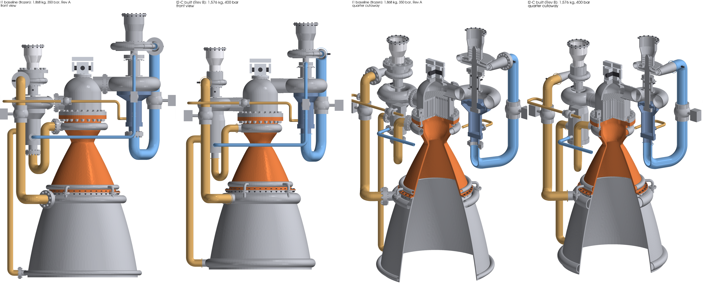

Drawings: the I2-C set is issued as revision B under the same drawing numbers in `drawings/I2-C/` (`MFE280-I2-C-DWG-SET.pdf`, 11 sheets: GA-001, TCA-002, INJ-003, TPO-004, TPF-005, JNT-006, VIS-007, VIS-008, MFG-009, VIS-010, VIS-011; `MFE280-I2-C-PID-SET.pdf`, PID-000 to PID-004), built with `drawings/src/build_set.py --iter I2-C`. Every sheet of the iteration-1 set is regenerated from the I2-C model, with weld symbols at the welded joints. The section-view and 3D sheets are extended, and a build-strategy sheet (MFG-009) shows the hybrid route of every part with its cost. The P&ID shows the laser igniters, the hydrostatic bearing supply from the CH4 discharge and the welded lines. The iteration-1 set stays as issued (revision A), with a build-strategy addendum in `drawings/I1-addendum/`.

CFD: both nozzles (I1 and I2-C) and their sea-level plumes ran in OpenFOAM (section 12). `cfd/post_compare.py` turns the exit-plane monitors into thrust and Isp, compares them with the ideal 1-D flow of the same gas, and plots the convergence (`figures/pgf/fig15_cfd_convergence.png`). The vacuum thrust-coefficient ratio is 0.983 for both iterations, against the η_Cf = 0.98 that the cycle model assumes.

## 18. Limitations and next steps

- Heat flux: Bartz is uncalibrated, and a ±20 % change moves the fuel-pump discharge by up to 213 bar. Calibrate against hot-fire data or conjugate CFD.
- Wall layer: The stream-tube wall bias has no film-decay physics. Next: a gaseous film model (Grisson or Simon type) or CFD.
- Preburners: Ideal gas with frozen complete combustion, while Z ≈ 1.2 at preburner conditions. The reactor check in section 15 shows the fuel-rich preburner burning near 1,000 K rather than 1,100 K at its design O/F; at 1,000 K the CH4 pump discharge rises by 131 bar. Next: a kinetics-coupled preburner model (primary zone plus dilution), real-gas turbine expansion (CoolProp mixtures or Peng-Robinson), and soot and coking of the fuel-rich products.
- Turbines: One stage, parabolic efficiency curve, simple clearance loss. Next: a meanline loss model (Kacker-Okapuu); option C5 currently stands in for a two-stage turbine with a higher peak efficiency only.
- Off-design: Throttle is first-order: pc scales with thrust at fixed O/F. A transient start and throttle model with pump maps is needed.
- Rotordynamics: Not modelled. With a 10 bar inlet the CH4 shaft is 52 mm at 56,000 rpm and the CH4 inducer tip runs at 307-335 m/s (261 m/s today). The cycle model holds the cavitation limit (Nss) but not inducer blade stress or critical speeds, so options Y1 and Y2 need a rotordynamic and inducer stress check before they count.
- Structures: First-cut checks only. No thermal stress or low-cycle fatigue in the liner. Next: FEA of the liner and ribs with the thermal gradient, and the injector faceplate.
- CAD: Layout level. I1-I4, N2, C1, C2 and K1 are modelled as geometry in the I2-C build; I5 (bimetallic chamber and nozzle) is still a bill-of-materials estimate.
- Options: Deltas are added linearly to form the iteration-2 candidates; I2-C is built and agrees with its estimate within 6 kg. I2-A and I2-B are not built.
- Plasma model: GRI-Mech 3.0 is not validated at 350-700 bar or at O/F 54 and 0.27, the PSR is the well-mixed limit, and the energy branching comes from air.
- Economics: Many rates are assumed (marked in `config/costs.yaml`), the custom-valve cost has no public anchor, the hybrid strategy picks each group independently (it can pair printed injector posts with a machined body), and operations, refurbishment and reuse are not costed.
- Benchmark data: All Raptor data is public and approximate. No proprietary information was used.

## 19. References

- Gordon, S., McBride, B. J. (1994, 1996). Computer program for calculation of complex chemical equilibrium compositions and applications. NASA RP-1311.
- Goodwin, D. G., et al. Cantera: an object-oriented software toolkit for chemical kinetics, thermodynamics and transport processes, v3.2.
- Bell, I. H., Wronski, J., Quoilin, S., Lemort, V. (2014). Pure and pseudo-pure fluid thermophysical property evaluation and the open-source thermophysical property library CoolProp. Ind. Eng. Chem. Res. 53, 2498-2508.
- Bartz, D. R. (1957). A simple equation for rapid estimation of rocket nozzle convective heat transfer coefficients. Jet Propulsion 27(1), 49-51.
- Gnielinski, V. (1976). New equations for heat and mass transfer in turbulent pipe and channel flow. Int. Chem. Eng. 16, 359-368.
- Haaland, S. E. (1983). Simple and explicit formulas for the friction factor in turbulent pipe flow. J. Fluids Eng. 105, 89-90.
- Rao, G. V. R. (1958). Exhaust nozzle contour for optimum thrust. Jet Propulsion 28(6), 377-382.
- Huzel, D. K., Huang, D. H. (1992). Modern Engineering for Design of Liquid-Propellant Rocket Engines. AIAA Progress in Astronautics and Aeronautics 147.
- Sutton, G. P., Biblarz, O. (2017). Rocket Propulsion Elements, 9th ed. Wiley.
- Gülich, J. F. (2010). Centrifugal Pumps, 2nd ed. Springer.
- NASA SP-8052 (1971) Liquid rocket engine turbopump inducers; SP-8107 (1974) Turbopump systems for liquid rocket engines; SP-8110 (1974) Liquid rocket engine turbines.
- VDI 2230 Part 1 (2015). Systematic calculation of highly stressed bolted joints.
- Gradl, P. R., et al. (2019). GRCop-42 development and hot-fire testing using additive manufacturing powder bed fusion for channel-cooled combustion chambers. AIAA 2019-4228.
- ISO 10628-1 and -2 (P&ID presentation and symbols), ANSI/ISA-5.1 (instrument identification), ISO 5457 (sheet sizes and frame), ISO 7200 (title blocks), ISO 128-20/-40/-44/-50 (lines, views, sections, hatching), ISO 5456-2 (projection methods), ISO 129-1 (dimensioning), ISO 3098 (lettering), ISO 2768-1 (general tolerances).
- Wikipedia, "SpaceX Raptor" (accessed 2026-10-31), for the public Raptor figures and their original SpaceX and FAA sources.
- Koelle, D. E. TRANSCOST 8.2 cost model, as reproduced in DLR elib 202157 (https://elib.dlr.de/202157/2/main.pdf) and MDPI Aerospace 6(11):123 (2019).
- NASA Spacecraft/Vehicle Level Cost Model (SVLCM), via University of Maryland ENAE 483 lecture notes, 2024.
- NASA Office of Inspector General (2023). NASA's management of the Space Launch System RS-25 engines, IG-23-015.
- NASA Cost Estimating Handbook (2002), section 7.6, learning curves.
- Additive Manufacturing Media (2021). Plotting a pathway to profitable AM (L-PBF Inconel 718 part cost).
- NASA Stennis Space Center test cost data, NTRS 20100026414.
- Moog cryogenic ball valve datasheet; Parker Autoclave large-bore ball valve datasheet (COTS valve limits).
- U.S. Bureau of Labor Statistics (2025). Occupational Outlook Handbook: aerospace engineers.
- Rusterholtz, D. L., et al. (2013). Ultrafast heating and oxygen dissociation in atmospheric pressure air by nanosecond repetitively pulsed discharges. J. Phys. D: Appl. Phys. 46.
- Shkurenkov, I., Adamovich, I. V. (2016). Plasma Sources Sci. Technol. 25, 015021 (energy partition in nanosecond pulse discharges in air).
- Popov, N. A. (2016). Plasma Sources Sci. Technol. 25, 043002 (review of plasma-assisted ignition kinetics).
- Starikovskiy, A., Aleksandrov, N. (2013). Plasma-assisted ignition and combustion. Prog. Energy Combust. Sci. 39, 61-110.
- Ju, Y., Sun, W. (2015). Plasma assisted combustion: dynamics and chemistry. Prog. Energy Combust. Sci. 48, 21-83.
- Xu, D. A., Lacoste, D. A., Laux, C. O. (2016). NRP ignition of lean propane-air mixtures up to 10 bar. https://hal-centralesupelec.archives-ouvertes.fr/hal-01244696
- Deak, N., Bellemans, A., Bisetti, F. (2021). 0-D modelling of NRP ignition of methane-air from 0.5 to 30 atm. Proc. Combust. Inst. https://dipot.ulb.ac.be/dspace/bitstream/2013/324862/5/PCI_Deak2020.pdf
- Kopecek, H., et al. (2003). Laser ignition of methane-air mixtures at high pressures. Proc. SPIE 5147.
- Formula E Gen3 battery data; Honeywell 1 MW generator (2022); NASA Kilopower (NTRS 20180000691); SP-100 programme data (power-source specific power and energy).
- Smith, G. P., et al. GRI-Mech 3.0 (http://combustion.berkeley.edu/gri-mech/).

