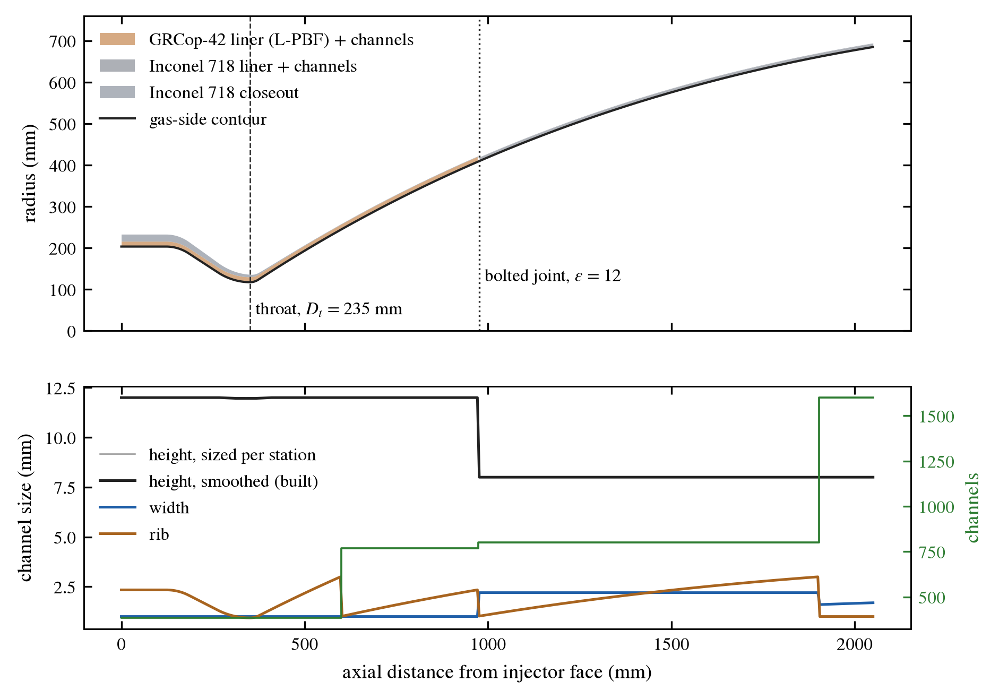
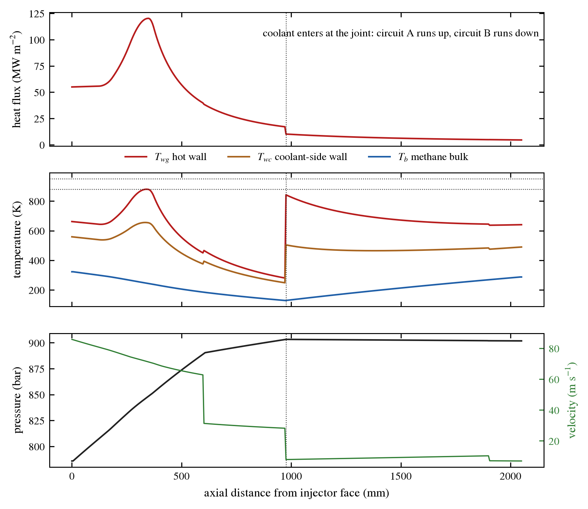
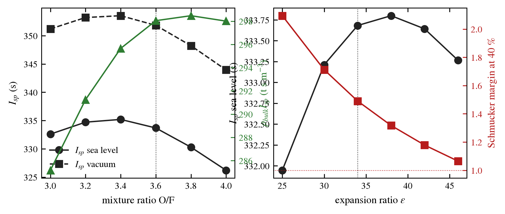
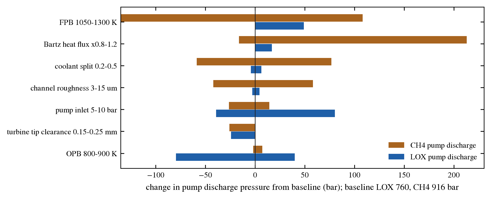
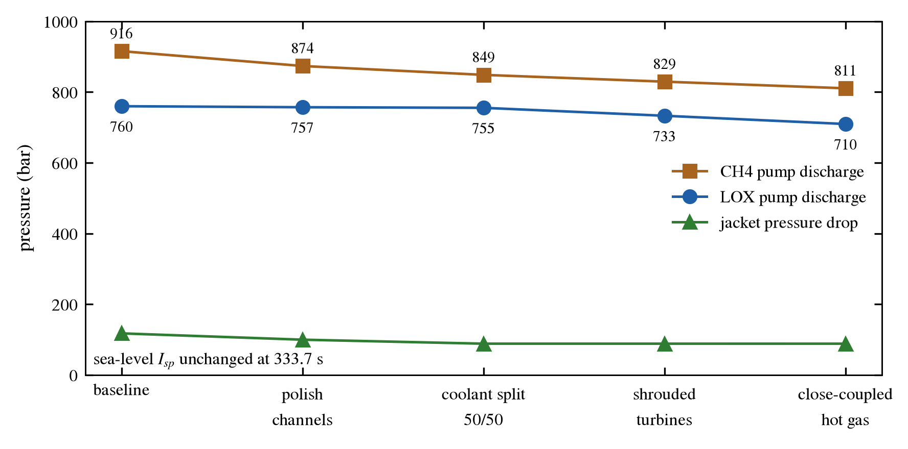
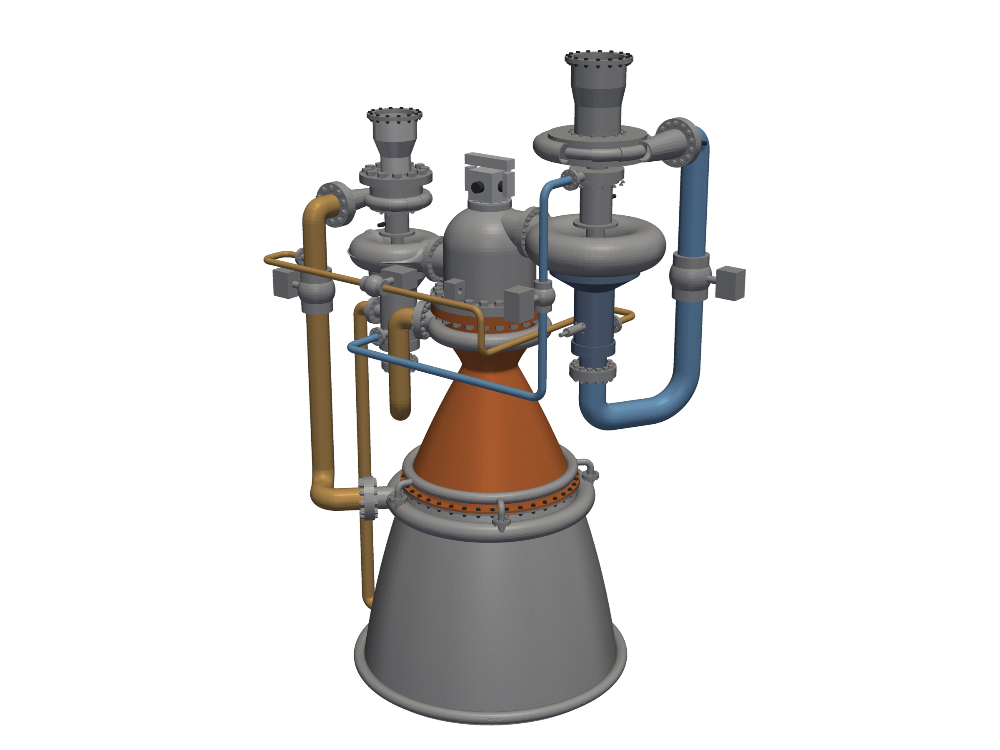
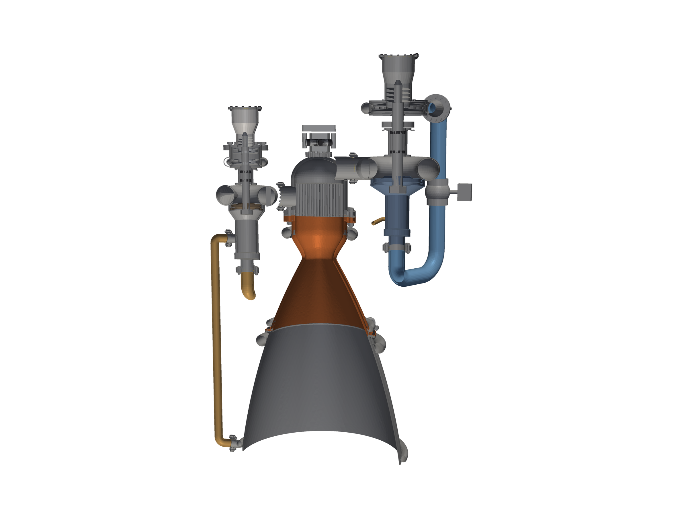

# MFE-280 design report, iteration 1

Sid Sharma, 2026-10-31. Personal project.

## 1. Purpose and scope

MFE-280 is a sea-level methane/oxygen engine with a full-flow staged-combustion (FFSC) cycle. Its requirements match the public Raptor 3 sea-level figures, so every model output can be checked against a known design point; the layout and sizing are my own. The work has four aims:

1. build a traceable design chain from thermochemistry to a bolted CAD assembly, using open tools only;
2. benchmark the result against Raptor 3 and find out where the gaps come from;
3. test changes that improve the design without adding much complexity;
4. leave a clean starting point for CFD.

All models are 0-D or 1-D. They are first-iteration tools, and section 13 lists what they leave out.

## 2. Benchmark

Public Raptor numbers (Wikipedia "SpaceX Raptor", accessed 2026-10-31, which collects SpaceX posts and the FAA material):

| Quantity | Raptor 1 | Raptor 2 | Raptor 3 |
|---|---|---|---|
| Sea-level thrust | 185 tf | 230 tf | 280 tf target (Apr/Aug 2024); 250 tf flight figure (May 2026) |
| Specific impulse (as quoted) | 350 s | 347 s | 350 s |
| Engine mass, engine only | 2,080 kg | 1,630 kg | 1,525 kg |
| Engine + vehicle-side hardware | 3,630 kg | 2,875 kg | 1,720 kg |
| Chamber pressure | ~250-300 bar | - | 350 bar demonstrated (May 2023 test, 269 tf) |
| Expansion ratio (sea level) | 34.34 (FAA 2019 plume analysis) | - | - |
| Mixture ratio | ~3.6 | ~3.6 | ~3.6 |
| Size | 1.3 m diameter, 3.1 m length | | |

The quoted 350 s needs care. At 350 bar, O/F 3.6 and ε 34, an ideal shifting-equilibrium nozzle (this project's Cantera solver, NASA CEA thermodynamic data) gives 349.0 s at sea level and 367.6 s in vacuum. No real engine delivers more than the ideal value, so 350 s cannot be the delivered sea-level Isp. It does fit the vacuum Isp of the sea-level engine. The same holds for Raptor 1's 350 s at roughly 250 bar. This project's sea-level engine delivers 351.8 s in vacuum, which agrees with the quoted figure. This report compares sea-level Isp on that basis.

## 3. Design basis

All inputs are in `config/baseline.yaml`. The main ones:

| Item | Value | Note |
|---|---|---|
| Thrust, sea level | 2,746 kN | 280 tf |
| Chamber pressure | 350 bar | |
| Mixture ratio | 3.6 | |
| Propellants at pump inlet | LOX 70 K, CH4 95 K, 6 bar | subcooled; tank ullage plus liquid head, assumed |
| c* efficiency / vacuum Cf efficiency | 0.990 / 0.980 | gas-gas injection, Rao bell |
| Contraction ratio, L* | 3.0, 0.80 m | |
| Nozzle | Rao 80 % bell, ε 34 | |
| Liner, chamber zone | GRCop-42 (L-PBF), 0.6 mm hot wall, Twg ≤ 880 K | |
| Liner, nozzle zone | Inconel 718, 0.6 mm hot wall, Twg ≤ 950 K | |
| Preburner exit temperature | OPB 820 K, FPB 1,100 K | ox-rich turbine alloy (SX500 class); FPB turbine needs a cast superalloy |
| Main injector dP | 10 % pc | gas-gas |
| Preburner injector dP | 12 % of preburner pressure | |
| Hot-gas duct dP | 3 % pc | |
| Inducer suction specific speed | 32,000 (US units) | NASA SP-8052 range |
| Throttle range | 40-100 % | public Raptor figure |

## 4. Models

### 4.1 Thermochemistry and performance (`ffsc/thermo.py`)

- Cantera 3.2 ideal-gas phase with NASA CEA polynomials (200-6,000 K, `nasa_gas.yaml`) for 18 C/H/O species. Transport properties use GRI-Mech 3.0 parameters (mixture-averaged).
- Reactant enthalpies follow the CEA convention: O2(L) at 90.17 K and CH4(L) at 111.64 K, corrected to the subcooled inlet state with CoolProp. In a closed cycle all pump work returns to the flow through the turbines, so the chamber total enthalpy equals the propellant enthalpy at the pump inlets.
- Chamber state: HP equilibrium. Expansion: isentropic, shifting or frozen. The throat is the point of maximum mass flux along the isentrope, so the method needs no explicit equilibrium sound speed. Exit state: the pressure where Gt/G equals ε.
- Delivered performance: c* × 0.990 and vacuum Cf × 0.980.
- Wall bias: two stream tubes. The wall tube (8 % of the mass flow at O/F 2.0) and the core tube (O/F 3.82) together keep O/F 3.6 overall. Isp and c* are mass-weighted.

Check against NASA CEA (RocketCEA 1.2.3, `scripts/validate_cea.py`, `results/cea_validation.json`). For the same reference liquids, 12 cases (250 and 350 bar, O/F 3.0 to 4.0, ε 12 and 34) agree within 0.14 % on chamber temperature, 0.05 % on c* and 0.04 % on vacuum Isp. At the design point, CEA gives 349.4 s ideal sea-level Isp and this solver gives 349.5 s. The throat Mach number from the maximum-mass-flux search is within 0.05 of 1.

### 4.2 Chamber and nozzle contour (`ffsc/nozzle.py`)

- The cylinder length is solved so that the volume from the injector face to the throat equals L* At.
- Convergent: 30° cone with a 0.6 Rc fillet and a 1.5 Rt upstream throat arc. Divergent: a 0.382 Rt arc, then a quadratic Bézier to the exit (Rao thrust-optimised parabola).
- Bell angles come from a digitised 80 % Rao chart (Huzel and Huang 1992). The error is about ±1°.
- Separation at sea level: Summerfield (pe/pa < 0.4) and Schmucker, pe/pa < (1.88 Me − 1)^−0.64.

### 4.3 Regenerative cooling (`ffsc/cooling.py`)

- Gas side: Bartz (1957) with the σ property correction, recovery temperature with r = Pr^1/3, and stagnation temperature η_c*² Tc of the wall stream tube.
- Wall: 1-D conduction through the hot wall. Ribs are straight fins, with the fin efficiency in the effective coolant-side coefficient.
- Coolant side: Gnielinski with a Haaland rough-wall friction factor, the Norris roughness enhancement and a (Pr/Pr_w)^0.11 correction. Supercritical methane properties come from CoolProp (Setzmann-Wagner EOS).
- Circuit: the coolant enters a manifold at the liner joint (ε 12). Circuit A runs up the copper chamber to the injector end; circuit B runs down the Inconel nozzle to the exit. The coldest methane therefore meets the throat. A single counter-flow pass from the exit was tried first: it needed about 670 bar of jacket pressure drop.
- Channel sizing is the computational step. The channel width is capped by liner bending, σ = ½ Δp (w/t)² (1.0 mm in copper, 2.2 mm in Inconel). Channels bifurcate when a rib would get too wide. At each station the model then finds the tallest channel that keeps the hot wall at its target temperature. Taller channels mean lower velocity and less pressure loss. The sized heights are smoothed conservatively (running minimum, then mean) and the jacket is solved again with that fixed profile. This profile is the geometry input for the PicoGK chamber.
- Structure checks per station: liner bending, rib tension (p w / rib) and the closeout. Coolant pressure inside closed channels is self-equilibrated, so it only bends the closeout across one channel width. Global hoop load comes only from the gas pressure, which sets a 17 mm closeout in the 350 bar chamber and 1 mm at the exit. Sizing it as a full-circumference vessel against coolant pressure would give a 144 mm closeout at the exit.

### 4.4 FFSC power balance (`ffsc/cycle.py`)

```
LOX pump -> MOV -> OPB (+ small CH4 cross-feed) -> ox turbine -> ox-rich gas -> main injector posts
CH4 pump -> MFV -> regen jacket A+B -> FPB (+ small LOX cross-feed via kick stage) -> fuel turbine -> fuel-rich gas -> injector annuli
```

- Preburners: frozen complete combustion of the minor propellant, with the major one unreacted, which is the usual preliminary assumption for short-residence preburners. The minor flow is solved so the frozen adiabatic temperature hits T_opb or T_fpb.
- Pressure chain: turbine exit = pc (1 + main injector dP + hot-gas dP). Preburner = turbine exit × turbine pressure ratio. Pump discharge = preburner × (1 + preburner injector dP) × (1 + line dP), plus the jacket dP on the fuel side.
- Each shaft: turbine power = pump power (+ kick stage on the LOX shaft), solved for the turbine pressure ratio. The balance curve has a maximum, so the solver takes the lowest root and reports when no root exists. That is how the 400 bar and wall-O/F 2.4 cases fail.
- The cooling and cycle models are coupled: the jacket dP and heat pickup feed the cycle, and the fuel-pump outlet state feeds the jacket. Two iterations converge.
- Real-gas check: CoolProp gives Z = 1.21 for O2 at OPB conditions and 1.22 for CH4 at FPB conditions. The cycle uses ideal gas; section 13 covers this.

### 4.5 Turbomachinery (`ffsc/turbopump.py`)

- Shaft speed is set by the inducer: N = Nss NPSH^0.75 / √Q.
- Pump efficiency follows Gülich (2010, eq. 3.28) minus 0.04 for high-speed rocket service. Tip speed comes from a head coefficient of 0.55. The eye, exit width, inducer and volute throat are sized from flow coefficients.
- Turbine: single-stage reaction. The parabolic efficiency curve in u/c0 is multiplied by a tip-clearance loss of 1.5 × clearance / blade height. The mean speed is the value that maximises this product inside the tip-speed and h/D limits. Preburner gas at 650-700 bar is dense, so blades are short (5.9-7.5 mm). The clearance loss is therefore large, and the design is sensitive to it.
- Shaft diameter is sized from torsion at 250 MPa allowable.

### 4.6 Injector (`ffsc/injector.py`)

Gas-gas shear coaxial elements: ox-rich gas in the post, fuel-rich gas in the annulus, 10 % pc dP on both. The element count comes from about 16 kN per element. Ring pitch is the largest that fits the faceplate. Result: 173 elements on 8 rings, 27 mm pitch, 1.6 × the annulus OD. The faceplate open-area fraction of 30 % shows that gas-gas FFSC injection is limited by face area.

### 4.7 Structures and bolted joints (`ffsc/structures.py`)

A VDI 2230-style sizing for every bolted joint:

- separating force at proof pressure (1.2 × MEOP) on the seal diameter, plus external loads (nozzle side load = 5 % of thrust);
- joint stiffness factor 0.25 and separation safety 1.4;
- preload 75 % of bolt proof (A286 760 MPa, Inconel 718 1,030 MPa);
- bolt spacing between 2.5 d (wrench access) and 6 d (seal uniformity);
- flange thickness from ring bending.

If no ISO bolt pattern fits, the joint is marked welded. That happens for the 760 bar LOX pump volute cover and the 665 bar ox turbine housing. Raptor 3 went the same way for its high-pressure joints. The CH4 turbine housing gets an M30 pattern, but its bolt circle lies under the turbine exhaust collector where no wrench can reach, so `ffsc/design.py` welds that joint too.

### 4.8 Verification

`tests/test_models.py` (11 tests, all pass):

- agreement with NASA CEA within 0.3 %; ideal performance in the expected range, and frozen Isp below shifting;
- stream-tube O/F conservation;
- contour throat and exit radius, and L* volume;
- area-Mach inverse;
- F = ṁ Isp g0 and At = ṁ c*/pc;
- preburner mass conservation and shaft power balance;
- jacket energy balance within 3 %, and wall-temperature and stress limits;
- bolt clamp, spacing and stress for every joint;
- a deliberately impossible flange is rejected;
- no separation at 40 % throttle.

## 5. Baseline results

| Quantity | Value |
|---|---|
| Isp sea level / vacuum (delivered) | 333.7 s / 351.8 s |
| Isp without wall bias (same efficiencies) | 338.2 s / 356.6 s |
| Mass flow (LOX / CH4) | 839.2 kg/s (656.7 / 182.4) |
| Vacuum thrust | 2.895 MN |
| Throat / chamber / exit diameter | 235 / 407 / 1,370 mm |
| Chamber length to throat, total length | 351 mm, 2,050 mm |
| Exit pressure, exit Mach | 1.20 bar, 3.66 |
| Chamber temperature (core / wall tube) | 3,785 / 2,546 K |
| LOX pump | 1 stage + inducer, 15,730 rpm, 760 bar, 51.1 MW, η 0.78, D2 404 mm |
| CH4 pump | 2 stages + inducer, 37,870 rpm, 916 bar, 46.5 MW, η 0.80, D2 217 mm |
| Ox turbine | PR 1.68, η 0.78, Dm 380 mm, blade 7.5 mm, 820 K inlet |
| Fuel turbine | PR 1.76, η 0.77, Dm 256 mm, blade 5.9 mm, 1,100 K inlet |
| OPB / FPB | 665 bar, O/F 54 / 697 bar, O/F 0.27 |
| Cross-feeds | 11.3 kg/s CH4 to OPB; 45.9 kg/s LOX to FPB through a +36 bar kick stage |
| Regen jacket | 94.7 MW, 117 bar dP, outlet 313 K, peak heat flux 120 MW/m², peak Twg 880 K |
| Channels | 384 at the throat (1.0 mm x ~12 mm), bifurcating to 768; Inconel nozzle 800-1,600 |
| Thrust-chamber mass (analytic) | 356 kg (liner + ribs 257 kg, closeout 99 kg) |

Figures: `figures/fig01_contour_channels`, `fig02_cooling`, `fig03_pressure_ladder`, `fig08_throttle_separation`.




Points worth noting:

- The copper channels end up near the 12 mm height cap all the way through the throat (about 70 m/s methane). With the wall bias in place, throat cooling is not the limit. The jacket dP comes from the long chamber circuit.
- The Inconel hot wall jumps to 840 K at the joint because its conductivity is about 18 times lower than copper's. Moving the joint upstream of ε 12 would push it past 950 K. The joint location is therefore set by the nozzle alloy's temperature limit.
- At 40 % throttle, pe/pa = 0.48 against a Schmucker limit of 0.32 (margin 1.49), so the sea-level nozzle stays attached over the whole public throttle range.

## 6. Benchmark comparison

| | MFE-280 baseline | MFE-280 improved | Raptor 3 public |
|---|---|---|---|
| Sea-level thrust | 2.746 MN | 2.746 MN | 280 tf (2.746 MN) target |
| Isp vacuum, sea-level engine | 351.8 s | 351.8 s | 350 s (quoted) |
| Isp sea level | 333.7 s | 333.7 s | not public in this form |
| Chamber pressure | 350 bar | 350 bar | 350 bar |
| Modelled mass | 1,868 kg | 1,796 kg | 1,525 kg |
| Thrust/weight (sea level) | 150 | 156 | 184 at 280 tf, 164 at 250 tf |
| Exit diameter | 1.37 m | 1.37 m | ~1.3 m |
| Overall envelope | 3.36 m tall, 2.24 x 1.62 m | similar | 3.1 m, 1.3 m diameter |

The modelled mass leaves out harness, controller, actuators and purge lines, so the real gap is somewhat larger than the table shows. MFE-280 iteration 1 sits between Raptor 1 (2,080 kg) and Raptor 2 (1,630 kg). The width gap comes from the LOX turbopump. A 6 bar inlet with Nss 32,000 limits it to 15,700 rpm, which gives a 380 mm turbine and a large exhaust collector.

## 7. Trade studies

Each case reruns the whole chain (`scripts/run_trades.py`, `results/trades.json`).



- Mixture ratio: Sea-level Isp peaks near O/F 3.4 (335.2 s), while bulk-density Isp keeps rising to 3.8. O/F 3.6 is a vehicle-level compromise. The wall-bias penalty grows with O/F because the gap to the wall O/F grows.
- Expansion ratio: Sea-level Isp is flat between ε 30 and 42 (333.2-333.8 s). Larger ε adds chamber mass (+22 kg from 34 to 38) and lowers the 40 %-throttle separation margin (1.49 at 34, 1.18 at 42). ε 34 is right for this mission.
- Chamber pressure: 250 and 300 bar close easily. 400 bar does not close at OPB 820 K and FPB 1,100 K: the ox turbine runs out of power first.
- Wall bias (figure 6): A wall O/F of 2.4 does not close the cycle, because the jacket dP rises too far. Wall O/F 1.6 gives large wall margin. The stream-tube model, however, cannot say whether a thin wall layer survives mixing down to the throat. Bias fractions below about 6 % need a film-decay model before I would trust them.



- Sensitivities (figure 5), as the change in CH4 pump discharge:
  - Bartz heat flux ×1.2: +213 bar; the hot wall also reaches 922 K. This is the largest model uncertainty.
  - FPB temperature 1,050-1,300 K: +108 to −135 bar.
  - Channel roughness 3-15 µm: −42 to +58 bar.
  - Coolant split: up to −59 bar.
  - Turbine tip clearance: a 0.40 mm clearance makes the cycle infeasible.
  - Pump inlet pressure 6 → 10 bar: shaft speed 15,700 → 23,100 rpm, LOX turbopump envelope radius 351 → 289 mm.

## 8. Improvements without much added complexity



| Step (cumulative) | How | LOX / CH4 pump discharge |
|---|---|---|
| Baseline | | 760 / 916 bar |
| Polish AM channels, Ra 8 → 3 µm | abrasive-flow finish; process change only | 757 / 874 |
| Coolant split 30/70 → 50/50 | resize the circuit-B orifice | 755 / 849 |
| Shrouded turbine rotors, clearance 0.25 → 0.15 mm | integral tip shroud on the AM blisk | 733 / 829 |
| Close-coupled hot-gas path, dP 3 → 1.5 % pc | collector welded to the injector inlet; one flange pair less per side | 710 / 811 |

Sea-level Isp stays at 333.7 s throughout. The lower pressures thin the walls, flanges and bolts, and the CAD of the improved engine (`cad/output_improved/`) is 72 kg lighter (1,796 vs 1,868 kg).

Spending the margin on chamber pressure buys little. With the pump pressures capped at the baseline values, the improved engine reaches about 355-358 bar (+0.3 s), because the LOX shaft sits near its peak-power point. The margin is better used for life and robustness.

Options that each have a real cost, evaluated on top of the chain:

| Option | Effect | Cost |
|---|---|---|
| OPB 820 → 860 K | LOX discharge 710 → 676 bar | ox-rich alloy qualification at 860 K |
| Pump inlet 6 → 8 bar | LOX shaft 15,730 → 19,560 rpm, TPA envelope radius 346 → 309 mm, LOX discharge 695 bar | higher tank pressure on the vehicle |
| Wall O/F 2.0 → 1.8, share 8 → 7 % | jacket dP 88 → 50 bar, CH4 discharge 811 → 738 bar | −0.5 s Isp |

The CAD roll-up (figure 9) shows where the remaining gap to Raptor 3 sits: ducts, valves and flanges about 455 kg, and coolant manifolds plus jumpers about 140 kg. The cycle physics is close to Raptor's. The difference is integration: manifolds built into the AM chamber wall, turbine exhausts flowing straight into the injector, and fewer bolted joints. That is the next iteration's job, and PicoGK-style geometry is the right tool for it.

## 9. CAD assembly

`cad/build_engine.py` builds the assembly from `results/design.json` in FreeCAD 1.1 (headless). `cad/open_in_gui.py` opens it with material colours.




- Tree: `MFE280_Engine` holds Thrust_Chamber, Injector_Head, Gimbal, LOX_Turbopump, CH4_Turbopump (both as App::Part with their own placement), Plumbing and Instrumentation. There are 178 objects, each with Material, Quantity and Note properties.
- Outputs: `cad/output/MFE280.FCStd`, `MFE280_assembly.step`, one STEP per sub-assembly, `MFE280_hot_gas_volume.step` (gas-side solid for CFD), `bom.csv`, `mass_summary.json`, `layout.json` and `clash_report.json`.
- Bolted joints (sized in `ffsc/structures.py`):

| Joint | Bolts | BCD |
|---|---|---|
| Injector / chamber | 22 x M27 Inconel 718 | 529 mm |
| Nozzle joint (ε 12) | 40 x M12 A286 | 912 mm |
| LOX / CH4 inlet (vehicle interface) | 16 / 14 x M10 A286 | |
| LOX discharge, FPB feed | 14 x M16 / 14 x M14 Inconel 718 | |
| CH4 discharge | 10 x M20 Inconel 718 | |
| Ox / fuel hot gas | 22 / 20 x M12 Inconel 718 | |
| Nozzle return | 10 x M12 | |
| Ox / fuel cross-feeds; coolant jumpers (4) | 8 / 6 x M8; 8 x M8 per jumper | |
| Igniters | 4 x M6 | |
| Gimbal pad | 12 x M16 | |
| Turbopump casings (inlet, bearing housings, CH4 volute cover) | M10 tapped; 12 x M30 tapped on the CH4 volute cover | |
| LOX volute cover, ox turbine housing, CH4 turbine housing | welded | |

  374 bolts and screws in total. Through bolts carry ISO 4032 nuts and two ISO 7089 washers; casing screws go into tapped holes.
- Clash check: pairwise boolean intersection of all 178 solids, fasteners and turbopump internals included, after a bounding-box prefilter. Each overlap solid counts only if its centroid lies inside both parts, which removes OCC sliver artifacts from touching faces. A short allowlist covers contacts that exist by design: blades rooted 0.3-0.5 mm into their hub or shroud, bosses welded to the preburner shell, the collector-to-housing weld, casing screws in their (unmodelled) tapped holes, and each bolt stack in its own flange pair. Result: 0 clashes for the baseline and for the improved engine. Welded attachments (manifolds, jumpers, dome, bosses) are trimmed to their parent surfaces.
- Level of detail: layout level. Impellers have 6 + 6 backswept blades, inducers have 3 helical blades, and the turbines have full rotor and stator rows. Cooling channels are not in the FreeCAD solids; they are in the PicoGK model.

## 10. Computational engineering with PicoGK

The cooling model's sized channel geometry (`results/cooling_profile.csv`: count, width, rib, height, hot-wall and closeout thickness per station) drives a voxel model of the GRCop-42 chamber built with PicoGK 2.3. The program (`picogk/RegenChamber`, details in `picogk/README.md`) evaluates a signed-distance field of liner, ribs and closeout directly from the 1-D stations, so the printable geometry comes straight from the physics output.

At a voxel size that resolves the 0.6 mm hot wall, the full 0.41 m chamber needs about 17 GB even at 0.3 mm, so the build covers a periodic 7.5° sector with 8 base channels (16 after the bifurcation). It runs the full copper length, injector face to the ε 12 joint, and is built at two voxel sizes as a resolution check:

| | 0.15 mm | 0.10 mm |
|---|---|---|
| Voxel volume vs analytic 419,173 mm³ | +0.08 % | −0.10 % |
| Surface mesh volume | +0.07 % | +0.03 % |
| Watertight (bad edges) | yes (0) | yes (0) |
| Hot wall / channel width measured on the mesh | 0.600 / 1.000 mm | 0.600 / 1.000 mm |
| Channels found at z = 60 mm, throat, 900 mm | 8, 8, 16 | 8, 8, 16 |
| Peak memory, total time | 4.7 GB, 171 s | 10.6 GB, 524 s |

The mesh volume error falls at about second order between the two sizes. The coarse mesh has genus 23 against an ideal 16: the first millimetres of each splitter knife edge are thinner than one 0.15 mm voxel and come out perforated. Use 0.10 mm for anything that will be printed or meshed.

Building the solid exposed a geometry problem the 1-D model could not show. At the 384 → 768 bifurcation the new splitter rib (1.017 mm) is wider than the 1.0 mm channel it splits, so an abrupt switch would block the flow. The voxel model therefore uses a 10 mm blend in which the splitter grows from a knife edge and no channel exceeds 1.0 mm. The cooling model should get the same blend, with its own pressure-loss term, in the next iteration.


Integrating the coolant manifolds and the hot-gas inlet into this geometry (section 8) is the natural next step.

## 11. P&ID and drawings

The drawing sets follow my EM-P220 drawing standard (same sheet, title block and lettering, without the university logo). They are generated as DXF from Python (`drawings/src/`, ezdxf) and passed through AutoCAD 2025 in batch mode (`accoreconsole`). AutoCAD saves each sheet as DWG (2018 format) and plots it to PDF with `monochrome.ctb` and object lineweights, so the PDFs come from the same plot path as a manual AutoCAD plot.

The template (`drawings/src/sheet.py`) is shared by both sets:

- ISO 5457 sheet with filing margin, 50 mm zones counted from the frame centre, and centring marks;
- ISO 7200 title block, 180 x 47 mm, with the same fields and layout as my EM-P220 block;
- a two-row standards strip above the title block;
- ISO 3098 type B lettering (ISOCPEUR);
- ISO 128-20 line widths (0.7 / 0.5 / 0.25 / 0.18 mm) through layer lineweights, with ISO dashed and chain line types;
- ISO 128-50 hatching and ISO 129-1 dimensions;
- the ISO 5456-2 third-angle symbol in place of the logo, with the circles next to the small end of the cone.

P&ID set (`drawings/MFE280-PID-SET.pdf`, 5 sheets, built by `make_pid_set.py`):

| Sheet | Content |
|---|---|
| PID-000 (A3) | Legend: ISO 10628-2 symbol forms, ANSI/ISA-5.1 function symbols and the identification letters used, fluid codes, piping classes with design pressure = 1.2 x MEOP |
| PID-001 (A2) | Engine P&ID: both propellant trains, kick stage, cross-feeds, regen circuits A/B with FO-301, hot-gas lines, GOX and GCH4 autogenous pressurant taps, chill-down bleeds, GHe purge with regulator, relief and check valves, torch igniters, and the control loops PIC-101 (thrust through MOV/MFV), TIC-203 (OPB temperature through OPFV) and TIC-303 (FPB temperature through FPOV), plus shutdown interlock UZ-100 |
| PID-002 (A3) | Line list |
| PID-003 (A3) | Equipment and valve lists |
| PID-004 (A3) | Instrument index |

Every tag, line designation (inside diameter, fluid, line number, piping class) and number comes from one tag database (`drawings/src/pid_data.py`), which itself reads `results/design.json`. The diagram and the registers therefore cannot disagree.

The mechanical set (`drawings/MFE280-DWG-SET.pdf`, built by `make_mech_drawings.py`) has six A3 sheets. `drawings/src/extract_views.py` runs inside FreeCAD and writes exact hidden-line-removed outlines and cut faces of the model to `drawings/build/`. Every outline on the sheets is therefore the model itself, and all dimensions and tables read `results/design.json`.

| Sheet | Content |
|---|---|
| GA-001 | General arrangement: front, side and top views at 1:25, envelope, list of material by sub-assembly, key data |
| TCA-002 | Thrust chamber section A-A at 1:10, detail B of the injector/chamber flange, detail C of the throat channels at 10:1, channel geometry table |
| INJ-003 | Injector seen from the chamber with all 173 elements, section B-B, detail D of one coaxial element, ring table |
| TPO-004, TPF-005 | LOX and CH4 turbopumps with their preburners: sections E-E and F-F at 1:5, list of material, pump, turbine and preburner data |
| JNT-006 | Schedule of all 22 joints, with the welded ones and the reason for each, and a typical flanged joint |

Drawing the sections found model defects that the clash check of that time had missed, because it did not yet include fasteners or turbopump internals: an inducer hub smaller than the shaft, impellers without a bore, a stator ring overlapping its housing, CH4 turbine-housing bolts that no tool could reach under the exhaust collector, bosses wider than their mating pipes, and a mis-sized FPB feed duct. I fixed all of them in the model, extended the clash check, and regenerated the set from the corrected model.

## 12. CFD

`cfd/make_case.py` writes an OpenFOAM v2306 (ESI) case, `cfd/cases/mfe280_sl_axi`, from `results/contour.csv` and `design.json`. Details and run commands are in `cfd/README.md`.

Domain:

- a 5° axisymmetric wedge of the hot-gas path, from the chamber cylinder through the bell;
- the sea-level plume region, 12 exit diameters downstream and 5 exit radii outward, with a 20 mm nozzle lip.

Mesh: 9-block blockMesh, 178,374 cells. checkMesh passes, with maximum non-orthogonality 31° and skewness 0.91. First cells are sized for y+ ≈ 50 (20 µm at the throat).

Solver set-up:

- rhoCentralFoam with Kurganov fluxes, k-ω SST, and local time stepping to steady state.
- Inlet: total pressure 350 bar and total temperature 3,785 K.
- Walls are adiabatic. The cooling-profile wall temperature is an option.

Gas: a single equivalent gas with γ = 1.125, cp = 3,217 J/kg K and M = 23.26 kg/kmol. This γ reproduces the shifting-equilibrium exit pressure exactly. c* is within 0.22 % and sea-level Isp within 0.07 %, but exit static temperature is 9 % low. The true frozen chamber properties would give an exit pressure 21 % low, which matters for a separation study.

The flow solver has not been run yet; the estimate is 1 to 4 h on 8 ranks. Its first job is to check the 1-D exit pressure, Isp and throat mass flow. After that, it should check separation at 40 % throttle (`--pc-frac 0.4`).

## 13. Limitations and next steps

- Heat flux: Bartz is uncalibrated, and a ±20 % change moves the fuel-pump discharge by up to 213 bar. Calibrate against hot-fire data or conjugate CFD.
- Wall layer: The stream-tube wall bias has no film-decay physics. Next: a gaseous film model (Grisson or Simon type) or CFD.
- Preburners: Ideal gas with frozen complete combustion, while Z ≈ 1.2 at preburner conditions. Next: real-gas turbine expansion (CoolProp mixtures or Peng-Robinson) and a kinetics check of fuel-rich methane products, including soot and coking.
- Turbines: One stage, parabolic efficiency curve, simple clearance loss. Next: a meanline loss model (Kacker-Okapuu) and a two-stage option for the dense ox-rich gas.
- Off-design: Throttle is first-order: pc scales with thrust at fixed O/F. A transient start and throttle model with pump maps is needed.
- Structures: First-cut checks only. No thermal stress or low-cycle fatigue in the liner. Next: FEA of the liner and ribs with the thermal gradient, and the injector faceplate.
- CAD: Layout level. Next iteration: integrated manifolds and close-coupled hot gas in the geometry, then a fresh mass roll-up.
- Benchmark data: All Raptor data is public and approximate. No proprietary information was used.

## 14. References

- Gordon, S., McBride, B. J. (1994, 1996). Computer program for calculation of complex chemical equilibrium compositions and applications. NASA RP-1311.
- Goodwin, D. G., et al. Cantera: an object-oriented software toolkit for chemical kinetics, thermodynamics and transport processes, v3.2.
- Bell, I. H., Wronski, J., Quoilin, S., Lemort, V. (2014). Pure and pseudo-pure fluid thermophysical property evaluation and the open-source thermophysical property library CoolProp. Ind. Eng. Chem. Res. 53, 2498-2508.
- Bartz, D. R. (1957). A simple equation for rapid estimation of rocket nozzle convective heat transfer coefficients. Jet Propulsion 27(1), 49-51.
- Gnielinski, V. (1976). New equations for heat and mass transfer in turbulent pipe and channel flow. Int. Chem. Eng. 16, 359-368.
- Haaland, S. E. (1983). Simple and explicit formulas for the friction factor in turbulent pipe flow. J. Fluids Eng. 105, 89-90.
- Rao, G. V. R. (1958). Exhaust nozzle contour for optimum thrust. Jet Propulsion 28(6), 377-382.
- Huzel, D. K., Huang, D. H. (1992). Modern Engineering for Design of Liquid-Propellant Rocket Engines. AIAA Progress in Astronautics and Aeronautics 147.
- Sutton, G. P., Biblarz, O. (2017). Rocket Propulsion Elements, 9th ed. Wiley.
- Gülich, J. F. (2010). Centrifugal Pumps, 2nd ed. Springer.
- NASA SP-8052 (1971) Liquid rocket engine turbopump inducers; SP-8107 (1974) Turbopump systems for liquid rocket engines; SP-8110 (1974) Liquid rocket engine turbines.
- VDI 2230 Part 1 (2015). Systematic calculation of highly stressed bolted joints.
- Gradl, P. R., et al. (2019). GRCop-42 development and hot-fire testing using additive manufacturing powder bed fusion for channel-cooled combustion chambers. AIAA 2019-4228.
- ISO 10628-1 and -2 (P&ID presentation and symbols), ANSI/ISA-5.1 (instrument identification), ISO 5457 (sheet sizes and frame), ISO 7200 (title blocks), ISO 128-20/-40/-44/-50 (lines, views, sections, hatching), ISO 5456-2 (projection methods), ISO 129-1 (dimensioning), ISO 3098 (lettering), ISO 2768-1 (general tolerances).
- Wikipedia, "SpaceX Raptor" (accessed 2026-10-31), for the public Raptor figures and their original SpaceX and FAA sources.
