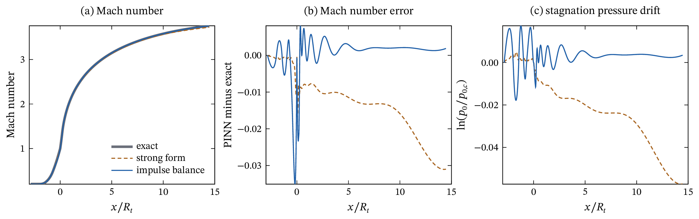
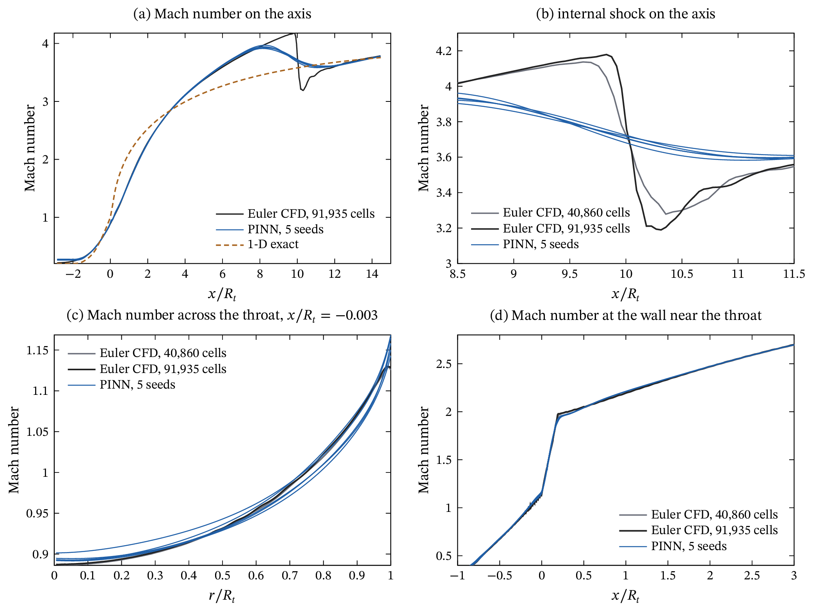
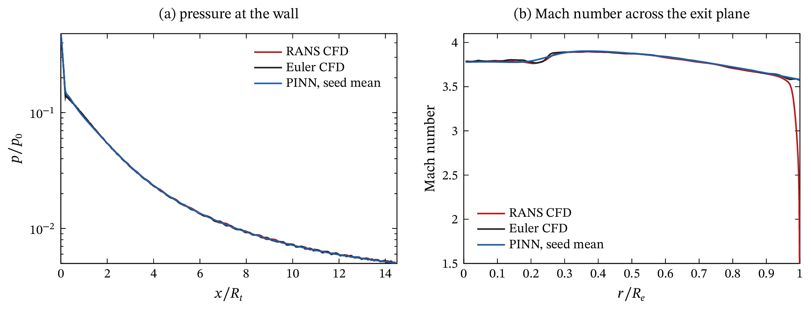
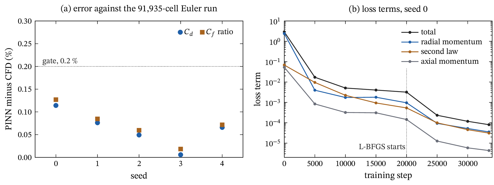

# PINN study of the MFE-280 nozzle

This folder trains physics-informed neural networks on the I2-C nozzle and compares them with the OpenFOAM runs. Training uses the governing equations, the contour, gamma and the chamber state. It uses no CFD data.

On the 2-D axisymmetric Euler problem, five seeds match the 91,935-cell Euler run to +0.06 % in Cd and +0.07 % in the vacuum Cf ratio, with a Mach error of 0.87 %. All five pass the gate. The PINN misses the internal shock in the bell: it spreads the Mach drop over about 3 Rt, and the largest Mach error is 0.47.

A seed takes 31 to 46 min on a 4 GB GPU, about the same as the warm-started Euler run, so the PINN has no advantage as a forward solver. A trained model returns all 91,935 cells in 0.25 s on the CPU. That speed and inverse work are the reasons to keep one.

## Gates

| Step | Case | Gate | Result |
|---|---|---|---|
| 1 | Liang et al. 1-D normal shock, gamma 1.4 | shock at x = 1.875 +- 0.02 | Fails: 1 of 3 seeds with the paper's recipe |
| 1 | `pinn4hcf` oblique shock, as shipped | in line with the thesis | L2 errors rho 1.47 %, p 2.12 %, u 0.47 %, v 7.53 %; thesis comparison not done |
| 2 | MFE-280 quasi-1-D, no shock | exit Mach and Isp within 0.1 %, ln p under 1 % | Passes on 3 seeds, with no exit value and no inlet state |
| 2 | MFE-280 quasi-1-D, normal shock at x/Rt = 5 | none set | Fails: exit Mach 2.38 against 0.119 |
| 2 | Inverse gamma from 50 analytic pressures, start 1.3 | none set | 1.12564, 1.12588, 1.12578 against 1.12600 |
| 3 | 2-D axisymmetric Euler | Mach L2 under 3 %, Cd and Cf within 0.2 % | Passes on 5 seeds |

Shock position in the Liang et al. case (true value 1.875):

| Form | Seed 0 | Seed 1 | Seed 2 |
|---|---|---|---|
| Non-conservative, no recipe | 1.866 | 2.250 | 2.250 |
| Non-conservative, the paper's recipe | 1.926 | 1.501 | 1.863 |
| Primitive outputs, conservative fluxes | 1.858 | 1.599 | 1.847 |
| Conserved outputs | non-finite | non-finite | non-finite |
| Impulse balance | 1.810 | 1.809 | 1.810 |

Seed 0 without the recipe lands near the shock with the wrong strength: downstream Mach 0.58 against 0.67 from the shock relations. The impulse balance repeats across seeds but sits 0.065 upstream, probably because its fixed scale comes from the supersonic branch.

Exit Mach number of the shock-free MFE-280 case (exact 3.7561):

| Form | Needs the exit pressure | Exit Mach |
|---|---|---|
| `paper`, the Liang et al. recipe | yes | -3.68, -3.70 (reversed flow) |
| `logvars`, relative residuals | yes | 3.7567, 3.7565 |
| `integrals`, strong form | no | 3.71 to 3.73 |
| `integrals`, impulse balance | no | 3.7572, 3.7558, 3.7560 |



## Findings

- A detached scale stops L-BFGS. A scale computed from the solution and detached inside the loss changes the loss value without appearing in its gradient. Strong-Wolfe L-BFGS then quits after a few hundred evaluations. A fixed scale from the 1-D solution cut the errors about 60-fold. `tests/test_pinn.py` checks the gradient of both models along a random direction.
- Impulse errors hide stagnation pressure errors. A relative impulse error e means a stagnation pressure error (1 + gamma M^2) e, which is 16.9 e at the exit. An L2 loss on the impulse undercounts the bell about 280 times. Dividing each balance by the pressure force pA restores its weight.
- The impulse balance suits a long bell. In the strong form, ln p0 drifts by 0.06 along the nozzle. The balance, anchored at the sonic station, removes the drift and takes no network derivative across a shock. It controls slow drift better than fast ripple, so ripples of up to 1.7 % in ln p0 remain upstream of the throat, and the largest Mach error of the 1-D case is -0.035.
- The balance needs an exit term. Without one, a false jump at the last station meets the exit pressure.
- L1 loss narrows a shock and moves it. Its cost grows with shock strength, so the shock slides upstream to where it is weaker.

## 2-D model

`axisym.py` solves the steady axisymmetric Euler equations with these choices:

- A stream function psi = m e F, with e = (r/R)^2 and F = 1 + 0.2 (1 - e) N. Mass, wall tangency and the axis condition hold exactly for any network. Cd comes out as the free parameter `lncd`.
- Speed from the 1-D baseline through a sigmoid, and temperature from total enthalpy, which holds across shocks here because the inflow is uniform.
- Control-volume momentum on a structured 360 x 48 grid, summed from the throat and scaled by the 1-D pressure force.
- p0 = 1 upstream of x/Rt = 2, and a one-sided second-law term everywhere.
- A 64 x 5 network, 20,000 Adam steps and 12,000 L-BFGS steps on the GPU.

## 2-D results

Scores against the 91,935-cell Euler run, with Cd 0.99480 and Cf ratio 0.98787. Mach L2 is over all cells.

| Seed | Cd | Cd error | Cf ratio | Cf error | Mach L2 | Mach L2, by volume | Largest Mach error | Training |
|---|---|---|---|---|---|---|---|---|
| 0 | 0.99594 | +0.114 % | 0.98912 | +0.127 % | 0.87 % | 0.36 % | 0.47 | 41 min |
| 1 | 0.99556 | +0.076 % | 0.98871 | +0.085 % | 0.86 % | 0.36 % | 0.47 | 45 min |
| 2 | 0.99529 | +0.049 % | 0.98846 | +0.060 % | 0.93 % | 0.39 % | 0.49 | 46 min |
| 3 | 0.99486 | +0.006 % | 0.98805 | +0.018 % | 0.91 % | 0.36 % | 0.48 | 44 min |
| 4 | 0.99546 | +0.066 % | 0.98858 | +0.072 % | 0.83 % | 0.34 % | 0.46 | 31 min |
| Mean field | 0.99542 | +0.062 % | 0.98858 | +0.072 % | 0.87 % | 0.36 % | 0.47 | |

The mean field also gives T 0.35 %, rho 0.61 % and ln p 1.22 %. The Isp ratio is 0.99313 against 0.99303 in the CFD, so the Cf error is almost all Cd error. Seed-to-seed scatter is about 0.04 % in both Cd and Cf.

Before the wedge correction in `cfd/post_compare.py`, these seeds read +0.19 % on Cd and +0.20 % on Cf. Two checks that do not use the sector factor support the correction: patch areas measured from the mesh, and mass flux summed across the chamber. Kliegel-Levine transonic theory for a wall radius of curvature of 1.5 Rt at the throat gives 0.9947 to 0.9952, which brackets the corrected CFD value of 0.9948.



Nearly all of the Mach error lies along the internal shock. On the axis the CFD falls from 4.18 to 3.19 over about 0.5 Rt, peak to trough, and the PINN falls from about 3.94 to 3.60 over about 3 Rt. It crosses the CFD at the right place, near x/Rt = 10. The largest seed spread is on the axis ahead of the shock (0.022 at x/Rt = 8.3), then in a thin band at the throat. The mean spread is 0.003.

RANS, Euler and the PINN give the same wall pressure, and at the exit plane the boundary layer appears only beyond r/Re = 0.97.





Contours are in `figures/pinn/step3`: CFD above and PINN below for Mach number, log10 pressure and temperature, the same fields as errors, close-ups of the throat and the shock, and the seed spread. They show seed 4, the seed closest to the mean Cd, on the real mesh.

## Cost

| Run | Size | Hardware | Start | Wall time |
|---|---|---|---|---|
| PINN, one seed | 360 x 48 stations, about 33,500 steps | RTX 3050 Ti, 4 GB | random | 31 to 46 min |
| Euler, `rhoCentralFoam` | 40,860 cells, 20,000 iterations | 4 ranks, i7-11800H | RANS solution | 46 min |
| Euler, `rhoCentralFoam` | 91,935 cells, 30,000 iterations | 8 ranks | mapped coarse Euler solution | 2 h 10 min |
| RANS, `rhoCentralFoam` | 40,860 cells, 20,000 iterations | 4 ranks | saved plume run | 2 h 01 min |
| RANS, HiSA, I1 nozzle | 43,380 cells, 3,000 iterations | 4 ranks | saved plume run | 41 min |

Seeds 1 to 3 shared the CPU with the finer Euler run. Seed 4 ran after it finished and took 31 min. The CFD times are warm starts and the PINN times are cold starts, so the table does not measure speed on equal terms.

## Limits

- The PINN does not resolve the internal shock, and the CFD shock is still sharpening with the mesh. Its width fell from 0.47 Rt to 0.22 Rt between the two meshes.
- All seeds read slightly high on Cd, and the cause is unknown. The Mach error near the throat changes sign along the nozzle, and the PINN rounds the sharp wall expansion at x/Rt = 0.18 by about 0.04 in Mach.
- Back-pressure shocks fail in the quasi-1-D model.
- The weights apply to I2-C at gamma 1.126. Neither source ships weights, and no other repository we have holds usable ones.
- The inverse gamma test used analytic pressures. The test on CFD wall pressures has not run.
- The `pinn4hcf` oblique-shock errors have not been compared with the thesis.

Step 5 of the plan comes next if it is wanted: gamma as a network input, a warm start on I1, and the field and gamma from wall pressures alone.

## Files

| Path | Content |
|---|---|
| `core.py` | Network, training loop and gradient helper |
| `nozzle1d.py` | Exact quasi-1-D solution with a normal shock |
| `paper_cd.py`, `paper_integrals.py` | Step 1: the Liang et al. case and its integral forms |
| `quasi1d.py` | Step 2: MFE-280 quasi-1-D forms and the inverse problem |
| `axisym.py` | Step 3: the 2-D model |
| `export_reference.py` | Case to compact reference file, in AetherCFD's environment |
| `score.py` | One set of weights against one reference |
| `ensemble.py` | All seeds against both Euler meshes, the seed table and the fields for rendering |
| `make_figures.py` | The four pgfplots figures |
| `../cfd/euler_nozzle.sh` | Euler restart of a nozzle-only run |
| `../cfd/render_pinn.py` | CFD and PINN contours on the real mesh |
| `../results/pinn/` | Reference fields, step results, weights |

## Commands

The environment is `D:\Research-Software\envs\pinn-nozzle-2026-11-04` (torch 2.14.1+cu126). Run from the repository root.

```bash
python -m pytest tests/test_pinn.py -q
python -m pinn.axisym --ref results/pinn/reference_I2C_euler.npz --out results/pinn/step3_axisym_seeds1to4.json --save results/pinn/weights --seeds 1 2 3 4 --nx 360 --nr 48 --adam 20000 --lbfgs 12000
python -m pinn.ensemble
python -m pinn.make_figures
```

Contours need AetherCFD's environment and a Windows copy of the case:

```bash
uv run --project D:/Research-Software/AetherCFD python cfd/render_pinn.py D:/OpenFOAM/MFE280_PINN/mfe280_I2C_sl_axi_r15_euler results/pinn/fields_I2C_euler_r15.npz r15_seed4 figures/pinn/step3 2400 1250
```

## Sources

- Liang et al., Sci. Rep. 14:3822 (2024): the 1-D nozzle recipe. Its code, `szl-c/pinn_CDnozzle`, has no licence. It was read only, and nothing here comes from it.
- Wagenaar, MSc thesis, TU Delft (2023), code `wagenaartje/pinn4hcf` (MIT): 2-D Euler PINNs with shocks.
- Kliegel and Levine, AIAA J. 7(7), 1969, DOI 10.2514/3.5355, as reproduced in Cao et al., FLOMEKO 2019: transonic Cd.
